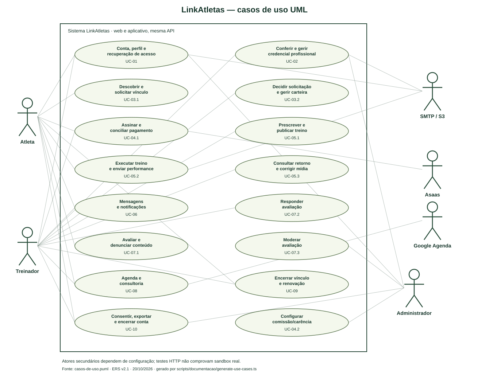

# Modelos atualizados da solução

Revisado em 26/10/2026. Fontes editáveis abaixo refletem API/migrations cumulativas e a [ERS completa v2.6](../requisitos/ERS-LinkAtletas.pdf). Modelo conceitual de classes não equivale à declaração de classes ORM: o backend usa módulos e SQL explícito. O adaptador contém as classes reais `AsaasClient` e `AsaasError`, identificadas no modelo técnico.

A pasta mantém uma representação técnica por modelo, com fonte editável e imagem. O DER é conferido contra o esquema exportado; as chamadas das sequências são conferidas contra o OpenAPI. Isso não substitui a revisão das regras de negócio ou uma consulta ao banco implantado.

| Modelo | Fonte | Visualização |
|---|---|---|
| Casos de uso UML | [PlantUML](casos-de-uso.puml) | [SVG vetorial](casos-de-uso.svg) |
| Classes conceituais | [Mermaid](classes.mmd) | [PNG](classes.png) |
| DER relacional | [Mermaid](der.mmd) | [PNG](der.png) / [SVG para ampliar](der.svg) |
| Sequência contratação/financeiro | [Mermaid](sequencia-contratacao.mmd) | [PNG](sequencia-contratacao.png) |
| Sequência treino/mídia/chat | [Mermaid](sequencia-treino.mmd) | [PNG](sequencia-treino.png) |
| Sequência autenticação | [Mermaid](sequencia-autenticacao.mmd) | [PNG](sequencia-autenticacao.png) |
| Sequência CREF manual | [Mermaid](sequencia-cref-manual.mmd) | [PNG](sequencia-cref-manual.png) |
| Sequência recuperação de senha | [Mermaid](sequencia-recuperacao.mmd) | [PNG](sequencia-recuperacao.png) |
| Sequência arquivo privado | [Mermaid](sequencia-upload-privado.mmd) | [PNG](sequencia-upload-privado.png) |
| Atividade validação profissional | [Mermaid](atividade-cref.mmd) | [PNG](atividade-cref.png) |
| Atividade acompanhamento esportivo | [Mermaid](atividade-acompanhamento.mmd) | [PNG](atividade-acompanhamento.png) |

O SVG de casos de uso usa atores, elipses de casos, associações e limite de sistema em notação UML, com fonte PlantUML equivalente. Substitui a limitação declarada do fluxograma Mermaid histórico, sem reclassificar retroativamente o diagrama antigo como UML formal.

O DER resume atributos/chaves relevantes das 37 tabelas das migrations 001–006, incluindo `schema_migrations` e `media_uploads`. As 47 relações FK foram conferidas no PostgreSQL, incluindo referências opcionais a usuário, revisor, auditoria, documento e sessões de upload. O [dicionário completo](../banco/dicionario-dados.md) registra 267 colunas, restrições e índices; [snapshot](../evidencias/api/database-schema.json) e [exportador](../../scripts/banco/export-schema.ts) permitem reproduzir a conferência. `pnpm docs:check` valida atributos/relações do DER e chamadas dos seis diagramas de sequência. A migration 005 garante correlação `provider_customer_id` e nulabilidade referencial da auditoria; a 006 acrescenta sessões de upload. Relações polimórficas `resource_id` de mídia/notificação e IDs de provedor/evento não são chaves estrangeiras relacionais; API os autoriza/concilia. `metric_types` valida JSON pelo servidor, sem FK de cada chave JSON.

O DER representa restrições físicas: por exemplo, um usuário pode ter zero ou um perfil no esquema relacional, enquanto o cadastro da aplicação cria ambos na mesma transação. O mínimo de um bloco por treino é validado pela aplicação; uma FK isolada não garante esse mínimo no banco. O modelo conceitual registra essas invariantes de domínio. Documento de verificação não tem unicidade global: várias submissões podem apontar para a mesma mídia autorizada.

Cardinalidades e regras: uma execução por ficha, uma avaliação por ciclo e uma assinatura por ciclo; contrato permite vários ciclos históricos e só um vigente por par via índice parcial. Documento de verificação é opcional; arquivo tem proprietário/finalidade/recurso. Saúde privada é opcional; consentimento tem chave por usuário/finalidade e histórico separado. Descrição de consultoria, mensagem, feedback, mídia e payload privado de execução são cifrados; não sugerir que o esquema inteiro ou campos públicos de reviews estão cifrados.

## Formatos e atualização

As fontes `.mmd` e `.puml` são editáveis. PNG permite leitura direta, e SVG permite ampliar sem perder nitidez. Fonte e imagem devem ser atualizadas juntas. `pnpm docs:check` confere o DER contra o esquema exportado e as chamadas das sequências contra o OpenAPI; não consulta o banco implantado.
