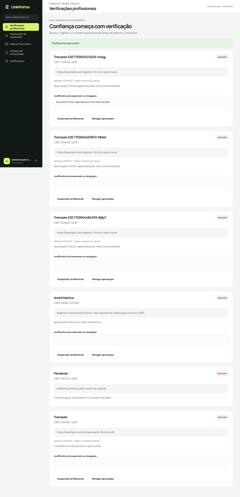
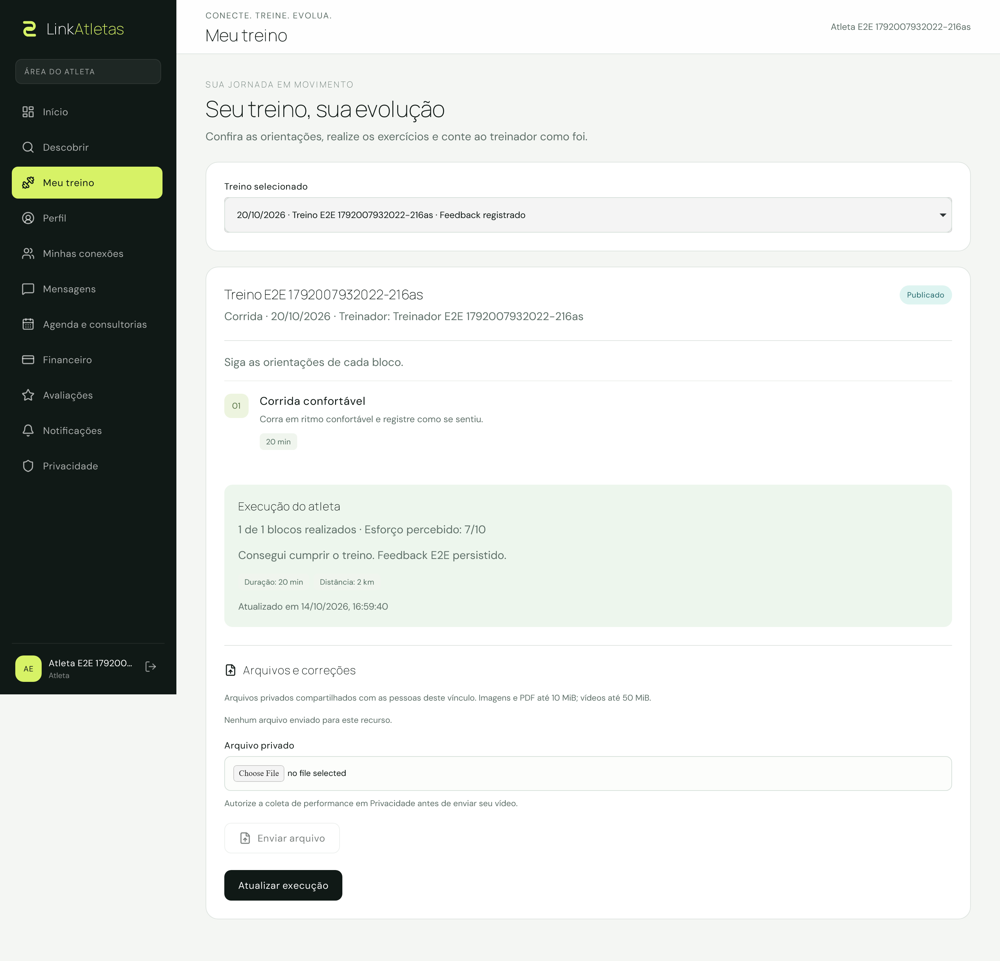
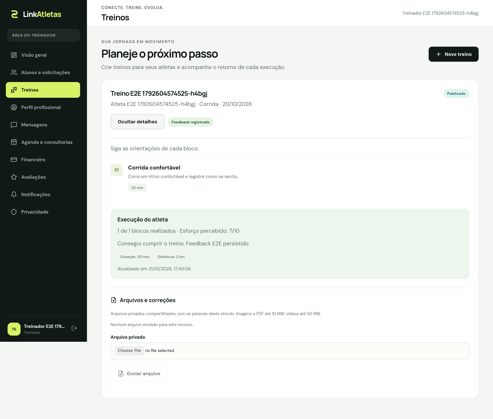
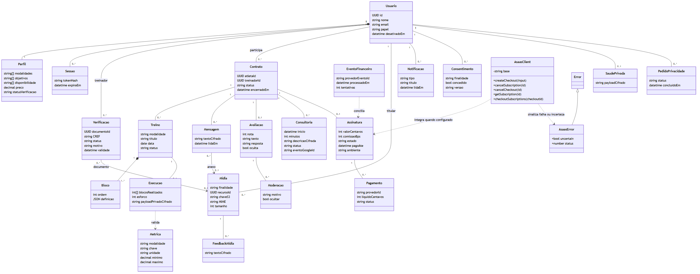

# ERS v2.4 - LinkAtletas

Data: 24/10/2026. Fonte textual das seções repaginadas do PDF; capa, identificação, histórico e seções iniciais são preservados do template e corrigidos pelos campos versionados.

Complemento das definições: SMTP — transporte de e-mail; MVP — produto mínimo viável. Match é a nota determinística de compatibilidade, distinta da avaliação pública. O CREF é conferido por uma pessoa; formato do número não comprova regularidade profissional.

### 1.4 Técnica(s) utilizada(s) para levantamento de requisitos

A especificação foi construída a partir da demanda SAGA nº 12871, da proposta Ivi-it e do roteiro acadêmico. A equipe consolidou requisitos por análise documental, discussão do fluxo esportivo e prototipação. Os protótipos históricos estão no Stitch; não se atribui sua produção ao Figma sem registro correspondente.

A revisão da Sprint 2 confrontou a ERS inicial, o backlog, os contratos da API, os modelos e as evidências de execução existentes. Não se registra entrevista ou homologação por cliente que não esteja documentada. As decisões de escopo são da equipe.

As tabelas de viabilidade anteriores preservam estimativas acadêmicas: investimento inicial de R$ 7.018,00, operação mensal de R$ 1.025,00 e trabalho de 408 horas a R$ 16,00 (R$ 6.528,00). Não são preços atuais pesquisados, gastos realizados ou serviços contratados. Os planos comerciais apresentados são hipóteses de evolução.

## 2 Requisitos Específicos

### 2.1 Requisitos funcionais

P0 identifica o fluxo essencial e P1 os complementos. Prioridade não comprova implementação ou homologação: cada requisito informa seu estado e limite. RF-01–24 preservam os identificadores originais; RF-A01–A08 identificam a ampliação já registrada, incorporada nesta seção sem duplicar a especificação em apêndices.

### RF-01 - Cadastro e edição de perfil do atleta

**Prioridade:** P0. Estado e limite: Implementado; evidências de API e interface.

**Descrição:** Criar conta de atleta e manter nome, cidade, modalidades, objetivos, níveis, orçamento, disponibilidade e atendimento. Dados privados de saúde são opcionais e dependem de consentimento específico.

**Atores:** Atleta

**Pré-condições:** Visitante para criar conta; titular autenticado para manter o perfil.

Fluxo principal:

1. Informar nome, e-mail e senha; o servidor valida a entrada, cria conta e perfil e inicia sessão.

2. Completar as preferências esportivas e salvar o perfil.

3. O servidor valida as opções e persiste as alterações; a próxima busca usa os dados atuais.

**Alternativas e exceções:** E-mail duplicado, senha inadequada ou opções inválidas impedem a gravação e exibem erro. Não há fila de aprendizagem ou recomendação em segundo plano.

**Pós-condição e aceite:** O titular reabre o perfil persistido; terceiros não podem alterá-lo.

### RF-02 - Cadastro e edição de perfil do treinador

**Prioridade:** P0. Estado e limite: Implementado; evidências de API e interface.

**Descrição:** Manter nome, bio, cidade, modalidades, objetivos, níveis atendidos, disponibilidade, formato de atendimento e preço. Bio reúne a apresentação profissional; não há cadastro separado de planos comerciais Starter/Pro/Business.

**Atores:** Treinador

**Pré-condições:** Visitante para criar conta; treinador autenticado para editar o próprio perfil.

Fluxo principal:

1. Criar conta com papel treinador e acessar o perfil.

2. Preencher os campos profissionais e salvar.

3. O servidor valida e persiste; a publicação na descoberta depende da aprovação profissional vigente.

**Alternativas e exceções:** Dados incompletos ou inválidos exigem correção. Editar o perfil não concede aprovação de CREF.

**Pós-condição e aceite:** Perfil salvo pertence ao titular e respeita a condição de publicação.

### RF-03 - Submissão de registro profissional

**Prioridade:** P0. Estado e limite: Implementado e testado com dados fictícios.

**Descrição:** Submeter CREF e evidência textual para análise administrativa. Documento privado de imagem/PDF é opcional; vídeo não é aceito como comprovação profissional. CREF deve ter de 4 a 50 caracteres e a evidência de 10 a 2.000 caracteres, conforme schema vigente.

**Atores:** Treinador

**Pré-condições:** Conta autenticada e perfil com modalidade, nível, objetivos e disponibilidade preenchidos.

Fluxo principal:

1. Informar CREF e evidência; anexar documento próprio se necessário.

2. O servidor valida formato, propriedade e finalidade do arquivo.

3. Persistir a submissão pendente e disponibilizá-la à administração.

**Alternativas e exceções:** Perfil incompleto, documento alheio ou perfil já aprovado geram erro. Validade de formato não comprova regularidade no conselho.

**Pós-condição e aceite:** Titular e administrador autorizado consultam a submissão; o pendente não entra na descoberta.

### RF-04 - Conferência manual do registro profissional

**Prioridade:** P0. Estado e limite: Implementado; procedimento manual definido pela equipe.

**Descrição:** O administrador consulta o portal oficial do conselho, compara CREF, titularidade e situação e registra a decisão. A consulta é humana: a aplicação não acessa nem certifica automaticamente os dados do conselho.

**Atores:** Administrador

**Pré-condições:** Submissão pendente e administrador autenticado.

Fluxo principal:

1. Abrir a submissão e conferir a fonte oficial.

2. Registrar no motivo a fonte, a data e o resultado da conferência; a evidência enviada pelo treinador permanece distinta desse registro administrativo.

3. Aprovar ou rejeitar com motivo de 5 a 1.000 caracteres; informar validade futura quando aplicável.

4. O servidor grava decisão, revisor e auditoria na mesma transação e atualiza o perfil.

**Alternativas e exceções:** Consulta indisponível ou dados insuficientes mantêm a análise pendente. Divergência exige rejeição motivada e eventual nova submissão. Decisão repetida é conflito. Sem prazo explícito, aprovação usa 365 dias como validade administrativa padrão, não como validade oficial da cédula.

**Pós-condição e aceite:** Somente aprovação vigente permite descoberta; não existe campo separado obrigatório de evidência de consulta nem automação de CREF no escopo atual.

### RF-05 - Autenticação e controle de acesso

**Prioridade:** P0. Estado e limite: Implementado; testes de sessão, papéis e origem.

**Descrição:** Autenticar e autorizar por papel, propriedade e estado. A web usa cookie HttpOnly; o app usa token Bearer opaco guardado no SecureStore. Atletas também acessam a web.

**Atores:** Atleta, treinador e administrador

**Pré-condições:** Conta existente e ativa; administrador provisionado por procedimento próprio.

Fluxo principal:

1. Informar e-mail e senha; o servidor verifica a credencial e inicia sessão.

2. Acessar funções permitidas ao papel e ao recurso solicitado.

3. Ao sair, invalidar a sessão; a recuperação segue RF-A01.

**Alternativas e exceções:** Credencial inválida, sessão expirada ou acesso indevido são negados. O cadastro público não permite criar administrador.

**Pós-condição e aceite:** Sessão válida autoriza somente recursos próprios/permitidos; logout impede reutilização.

### RF-06 - Processamento de matchmaking por regras

**Prioridade:** P0. Estado e limite: Implementado; testes unitários, API e carga sintética.

**Descrição:** Filtrar modalidade e compatibilidade de atendimento/cidade e calcular nota explicável: objetivos 30, nível 20, orçamento 25 e horário em comum 25. Sem correspondência, o critério não soma pontos. Não há modelo treinado.

**Atores:** Sistema, solicitado pelo atleta

**Pré-condições:** Atleta autenticado com preferências; profissionais aprovados e elegíveis.

Fluxo principal:

1. Consultar profissionais aprovados, ativos e com validade vigente.

2. Excluir incompatíveis em modalidade e atendimento; quando presencial exigir cidade, excluir cidade incompatível ou ausente.

3. Calcular score e razões; ordenar por score, nome e identificador para desempate.

**Alternativas e exceções:** Não há resultado quando os filtros eliminam todos os candidatos. A cidade incompatível no presencial não é apenas penalidade de nota. Não há cache de recomendações no caminho testado.

**Pós-condição e aceite:** Mesmas entradas produzem resultado determinístico e razões verificáveis.

### RF-07 - Busca e filtragem de treinadores

**Prioridade:** P0. Estado e limite: Implementado e testado.

**Descrição:** Consultar a descoberta por modalidade, texto, preço máximo e atendimento. O texto pesquisa nome, cidade e bio. Avaliações públicas não constituem filtro de nota mínima na versão atual.

**Atores:** Atleta

**Pré-condições:** Sessão válida.

Fluxo principal:

1. Abrir a descoberta e informar filtros disponíveis.

2. O servidor aplica elegibilidade, matching e filtros.

3. Exibir cards, score e razões; limpar filtros refaz a consulta.

**Alternativas e exceções:** Entrada inválida gera erro; ausência de resultados permite revisar filtros. Suspensão/expiração é verificada no servidor em nova consulta, sem garantia de atualização instantânea de toda lista já aberta.

**Pós-condição e aceite:** A resposta contém apenas treinadores elegíveis que atendem aos filtros suportados.

### RF-08 - Visualização do portfólio do treinador

**Prioridade:** P1. Estado e limite: Implementado; dados persistidos.

**Descrição:** Apresentar bio, modalidades, atendimento, cidade, preço, registro profissional, compatibilidade e avaliações publicadas. Documentos profissionais e mídias privadas não são portfólio público.

**Atores:** Atleta

**Pré-condições:** Acesso autorizado à descoberta.

Fluxo principal:

1. Selecionar um profissional exibido na descoberta.

2. Consultar os dados públicos e avaliações visíveis.

3. Iniciar solicitação de vínculo se o profissional continuar elegível.

**Alternativas e exceções:** Perfil indisponível ou inelegível não autoriza contratação. Não há biblioteca pública de vídeos ou campos de especialização independentes da bio.

**Pós-condição e aceite:** Nenhum documento privado é exposto ao visitante da descoberta.

### RF-09 - Solicitação de contratação e assinatura

**Prioridade:** P0. Estado e limite: Fluxo acadêmico implementado e testado; financeiro externo não homologado.

**Descrição:** Criar solicitação pendente de vínculo. O treinador decide antes da intenção financeira; não há pré-autorização de cartão durante o pedido.

**Atores:** Atleta

**Pré-condições:** Atleta autenticado e treinador elegível.

Fluxo principal:

1. Confirmar interesse no treinador.

2. O servidor revalida elegibilidade e unicidade de ciclo vigente e persiste o pedido.

3. Após o aceite, modo acadêmico mantém vínculo sem cobrança; modo Asaas configurado permite preparar checkout.

**Alternativas e exceções:** Duplicidade, papel incorreto ou profissional inelegível geram erro. Um ciclo anterior encerrado/recusado permite novo ciclo sem mover seu histórico.

**Pós-condição e aceite:** Pedido persistido fica disponível somente às partes autorizadas.

### RF-10 - Aceite ou recusa de solicitação de aluno

**Prioridade:** P0. Estado e limite: Implementado; inclusive teste de aceite concorrente.

**Descrição:** Decidir exclusivamente sobre os pedidos destinados ao treinador, com transação e preservação do ciclo.

**Atores:** Treinador destinatário

**Pré-condições:** Solicitação pendente e profissional elegível para aceitar.

Fluxo principal:

1. Consultar pedidos e perfil do solicitante.

2. Aceitar ou recusar; o servidor bloqueia o registro e verifica o destinatário e estado.

3. Atualizar vínculo/carteira. No modo financeiro, acesso depende da vigência aplicável.

**Alternativas e exceções:** Terceiro não decide; concorrência ou nova decisão sobre pedido resolvido gera conflito. Recusa não inicia cobrança nem reduz a nota do match.

**Pós-condição e aceite:** Uma única decisão efetiva é persistida para a solicitação.

### RF-11 - Pagamento recorrente

**Prioridade:** P1. Estado e limite: Adaptador e testes HTTP controlados existentes; homologação sandbox prevista para continuidade financeira da Sprint 3.

**Descrição:** Preparar checkout hospedado e acompanhar assinatura por eventos autenticados. O provedor gerencia cobrança; a aplicação não recebe dados brutos de cartão.

**Atores:** Atleta, sistema e Asaas configurado

**Pré-condições:** Ciclo aceito; modo Asaas, plano, carteira e credenciais configurados.

Fluxo principal:

1. Persistir intenção única e solicitar checkout recorrente ao provedor.

2. Apresentar URL hospedada ao atleta.

3. Receber webhook autenticado e persistir evento único.

4. Processar evento e atualizar estado e vigência.

**Alternativas e exceções:** Sem configuração não há sucesso externo. Timeout mantém resultado incerto para conciliação; redirect não confirma pagamento. Modo acadêmico não cobra.

**Pós-condição e aceite:** Estado financeiro decorre de evento/reconciliação válidos, sem duplicar intenção local.

### RF-12 - Divisão de pagamento

**Prioridade:** P1. Estado e limite: Testado com respostas HTTP controladas; repasse externo não homologado.

**Descrição:** Solicitar split no checkout e registrar eventos/valores. Estimativa de participação não é comprovação de liquidação ou repasse bancário.

**Atores:** Sistema e provedor financeiro

**Pré-condições:** Carteira elegível, comissão configurada e modo Asaas.

Fluxo principal:

1. Ler carteira e comissão administrativa.

2. Enviar a participação ao provedor no checkout.

3. Processar eventos autenticados e registrar referências, valores e estados dos splits.

**Alternativas e exceções:** Carteira/configuração inválida impede a operação; falha externa segue conciliação. A aplicação não assume poder de reter ou liberar saldo bancário por conta própria.

**Pós-condição e aceite:** Cálculos e eventos são rastreáveis, com validação real de split ainda pendente no provedor.

### RF-13 - Inadimplência e carência

**Prioridade:** P1. Estado e limite: Testes financeiros controlados; serviço externo pendente de homologação.

**Descrição:** Manter estados de pagamento, período pago e carência configurada; suspender novas interações quando a regra de acesso exigir.

**Atores:** Sistema e jobs

**Pré-condições:** Assinatura financeira e eventos válidos.

Fluxo principal:

1. Registrar evento e preservar a vigência confirmada.

2. Aplicar carência e conciliar pendências por jobs.

3. Restaurar regularidade após confirmação ou bloquear novas ações ao terminar o prazo aplicável.

**Alternativas e exceções:** Evento antigo não reduz período pago. Criação de cobrança com resultado incerto não recebe repetição cega; histórico não é apagado por suspensão.

**Pós-condição e aceite:** Transições obedecem ao estado persistido, sem transformar erro em pagamento aprovado.

### RF-14 - Prescrição de fichas de treino

**Prioridade:** P0. Estado e limite: Implementado e testado no fluxo principal.

**Descrição:** Criar ficha com modalidade, data e blocos com orientações, metas e métricas; salvar rascunho por ação explícita ou publicar.

**Atores:** Treinador

**Pré-condições:** Ciclo ativo, aprovação profissional e acesso financeiro aplicável válidos.

Fluxo principal:

1. Selecionar o atleta do vínculo e preencher ficha/blocos.

2. Salvar rascunho privado ou solicitar publicação.

3. O servidor valida propriedade e catálogo e persiste; atleta consulta somente o publicado.

**Alternativas e exceções:** Dados inválidos impedem gravação. Terceiro não prescreve. Encerramento efetivo impede novas prescrições; não significa apagar fichas históricas.

**Pós-condição e aceite:** Rascunho reabre para o treinador e publicado aparece apenas ao atleta autorizado.

### RF-15 - Orientação e mídia demonstrativa

**Prioridade:** P1. Estado e limite: Implementado; serviços locais testados.

**Descrição:** Associar referência HTTPS por bloco e mídia privada de orientação ligada à ficha. Não existe biblioteca pública de exercícios gerida separadamente.

**Atores:** Treinador

**Pré-condições:** Ficha e vínculo autorizados.

Fluxo principal:

1. Informar referência HTTPS no bloco ou selecionar arquivo de orientação para a ficha.

2. O servidor valida finalidade, arquivo e autorização.

3. Armazenar mídia privada cifrada e permitir recuperação somente ao usuário autorizado.

**Alternativas e exceções:** Formato, tamanho ou propriedade inválidos são recusados. S3 local em desenvolvimento não comprova armazenamento hospedado em nuvem.

**Pós-condição e aceite:** Atleta do vínculo acessa orientação permitida; terceiros não baixam o arquivo.

### RF-16 - Consulta de treinos prescritos

**Prioridade:** P0. Estado e limite: Implementado; API, navegador e APK integrado.

**Descrição:** Listar fichas publicadas, blocos e referências de orientação; preservar o histórico do ciclo conforme autorização.

**Atores:** Atleta

**Pré-condições:** Sessão válida e acesso autorizado ao vínculo/ficha.

Fluxo principal:

1. Abrir a área de treinos.

2. Selecionar ficha publicada e consultar blocos, metas e orientação.

3. Iniciar registro de execução pelo RF-17.

**Alternativas e exceções:** Sem fichas publicadas, mostrar estado vazio. Rascunho privado e ficha de terceiro não ficam acessíveis.

**Pós-condição e aceite:** Somente fichas autorizadas são retornadas pela API e exibidas na interface.

### RF-17 - Registro de execução e feedback

**Prioridade:** P0. Estado e limite: Implementado e testado.

**Descrição:** Registrar blocos realizados, métricas do catálogo, esforço de 1 a 10 e observações, com payload privado cifrado e uma execução por ficha.

**Atores:** Atleta

**Pré-condições:** Ficha publicada autorizada e acesso válido.

Fluxo principal:

1. Marcar blocos concluídos e preencher métricas/esforço/observações.

2. O servidor valida chaves, limites e índices e grava a execução.

3. Atualização autorizada altera o mesmo registro; o treinador consulta o retorno.

**Alternativas e exceções:** Execução parcial é permitida; métricas desconhecidas, fora da faixa ou blocos inexistentes são recusados.

**Pós-condição e aceite:** Persistência mantém uma execução por ficha e não revela conteúdo a terceiros.

### RF-18 - Mídia de performance e correção técnica

**Prioridade:** P1. Estado e limite: Implementado; upload e correção verificados no APK integrado.

**Descrição:** Selecionar e enviar mídia privada de performance para análise do treinador. A versão móvel usa seletor de arquivos; câmera própria e upload retomável automático não são funcionalidades comprovadas. Tipos reconhecidos pelo módulo: PNG, JPEG, WebP, PDF, MP4 e WebM, respeitando a finalidade. Limites: 50 MiB por vídeo e 10 MiB nos demais tipos; a requisição multipart aceita um arquivo, sem campos adicionais, com teto global de 50 MiB. Comprovação profissional não aceita vídeo.

**Atores:** Atleta e treinador do vínculo

**Pré-condições:** Recurso autorizado e consentimento específico de performance concedido.

Fluxo principal:

1. Selecionar arquivo e enviar para o recurso autorizado.

2. Validar assinatura, MIME, extensão, tamanho, finalidade e consentimento; cifrar e armazenar.

3. O treinador acessa o arquivo autorizado e registra correção técnica.

**Alternativas e exceções:** Falha de envio mostra erro e permite nova ação do usuário, sem promessa de pausa/retomada automática. Revogação de performance elimina as mídias abrangidas pela política.

**Pós-condição e aceite:** Arquivo real pode ser recuperado por usuário autorizado; terceiro e consentimento ausente são negados.

### RF-19 - Mensagens em tempo real

**Prioridade:** P1. Estado e limite: Implementado; testes de duas sessões, web e APK.

**Descrição:** Manter histórico paginado e cifrado, envio REST, eventos WebSocket, leitura e anexos privados. Notificações são internas; não se afirma push do sistema operacional.

**Atores:** Participantes do vínculo

**Pré-condições:** Sessão e vínculo válidos para envio.

Fluxo principal:

1. Abrir conversa e recuperar histórico persistido.

2. Enviar texto/anexo autorizado; após commit o servidor publica para as partes.

3. Confirmar leitura por cursor; reconexão consulta o banco novamente.

**Alternativas e exceções:** Terceiro não acessa; vínculo encerrado não envia; sessão revogada fecha conexão. Múltiplas instâncias precisam de broker futuro.

**Pós-condição e aceite:** Troca entre as partes persiste e reaparece sem expor dados de outra conversa.

### RF-20 - Avaliação pública do treinador

**Prioridade:** P1. Estado e limite: Implementado e testado com condições de fixture identificadas.

**Descrição:** Publicar nota de 1 a 5 e texto, uma avaliação por ciclo, com edição pelo autor e média calculada sobre conteúdo visível.

**Atores:** Atleta

**Pré-condições:** Vínculo elegível ativo há sete dias por padrão, conforme configuração.

Fluxo principal:

1. Selecionar vínculo elegível e preencher nota e comentário.

2. Validar papel, vigência e período mínimo e persistir uma avaliação por ciclo.

3. Exibir avaliações visíveis e sua média; autor pode editar conforme autorização.

**Alternativas e exceções:** Avaliação precoce, duplicada, de terceiro ou sem vínculo ativo é recusada. Período reduzido em fixture não comprova transcurso real de sete dias.

**Pós-condição e aceite:** Critério temporal e unicidade são aplicados no servidor; comentário oculto não compõe a média pública.

### RF-21 - Resposta a avaliações

**Prioridade:** P1. Estado e limite: Implementado e testado.

**Descrição:** Responder à avaliação e permitir denúncia/moderação pelo fluxo RF-A08.

**Atores:** Treinador avaliado

**Pré-condições:** Avaliação visível do próprio treinador.

Fluxo principal:

1. Consultar avaliações recebidas.

2. Informar resposta e confirmar.

3. O servidor verifica o treinador destinatário e vincula a resposta à avaliação.

**Alternativas e exceções:** Outro profissional não responde; conteúdo oculto não recebe resposta pública. Denúncia segue análise administrativa motivada.

**Pós-condição e aceite:** Resposta pertence ao treinador avaliado e acompanha a avaliação correta.

### RF-22 - Encerramento de vínculo e assinatura

**Prioridade:** P1. Estado e limite: Fluxo local e contratos HTTP testados; cancelamento externo ainda não homologado.

**Descrição:** Retirar pedido pendente ou encerrar vínculo conforme estado. No acadêmico, encerrar sem cobrança; no Asaas, confirmar cancelamento da renovação e preservar período pago aplicável.

**Atores:** Participante autorizado

**Pré-condições:** Ciclo acessível ao participante.

Fluxo principal:

1. Informar motivo e confirmar a operação.

2. Autorizar o participante e bloquear o ciclo na transação.

3. Aplicar encerramento acadêmico ou solicitar cancelamento ao provedor, preservando histórico e vigência confirmada.

**Alternativas e exceções:** Repetição é idempotente; falha/timeout externo mantém pendência para conciliação, sem falso sucesso. Suspensão profissional pode impedir novas ações independentemente de vigência financeira.

**Pós-condição e aceite:** Novo ciclo não move fichas antigas; histórico é preservado e novas ações respeitam o estado efetivo.

### RF-23 - Gestão da carteira de alunos

**Prioridade:** P0. Estado e limite: Implementado e integrado ao back-end.

**Descrição:** Consultar solicitações e ciclos, prescrever, consultar execução, conversar, agendar e acompanhar o estado financeiro aplicável.

**Atores:** Treinador

**Pré-condições:** Treinador autenticado.

Fluxo principal:

1. Abrir carteira e selecionar o aluno/ciclo autorizado.

2. Consultar estado e histórico e acessar ações permitidas.

3. Ao encerrar, conservar registros e impedir novas operações incompatíveis com o estado.

**Alternativas e exceções:** Encerramento preserva fichas existentes e histórico; não elimina automaticamente treinos futuros. Terceiros não acessam a carteira.

**Pós-condição e aceite:** A carteira corresponde aos vínculos reais e seus estados persistidos.

### RF-24 - Meio de pagamento no provedor

**Prioridade:** P1. Estado e limite: Adaptador testado de forma controlada; homologação financeira futura.

**Descrição:** Encaminhar o atleta ao checkout hospedado; não manter formulário próprio de cartão ou carteira local de PAN/CVV.

**Atores:** Atleta e provedor configurado

**Pré-condições:** Modo Asaas configurado e ciclo elegível.

Fluxo principal:

1. Preparar intenção e obter URL de checkout pelo fluxo financeiro.

2. O atleta informa os dados somente no provedor.

3. Atualizar assinatura por eventos autenticados e conciliação, não pelo redirect.

**Alternativas e exceções:** Falta de configuração ou confirmação gera indisponibilidade/pendência. Rejeição de cartão ocorre no ambiente externo e só é refletida conforme eventos realmente recebidos.

**Pós-condição e aceite:** Dados brutos de cartão não entram no contrato da aplicação; operação real exige homologação do provedor.

### RF-A01 - Recuperação de acesso por e-mail

**Prioridade:** P0. Estado e limite: Implementado; SMTP local testado.

**Descrição:** Recuperar senha por token aleatório de uso único, hash persistido, expiração de 30 minutos e outbox SMTP.

**Atores:** Titular da conta

**Pré-condições:** Acesso ao endereço cadastrado e serviço SMTP configurado.

Fluxo principal:

1. Solicitar recuperação por e-mail; devolver resposta genérica.

2. Enviar link pelo SMTP; o titular informa token e nova senha.

3. Verificar/bloquear token, alterar hash e revogar sessões anteriores.

**Alternativas e exceções:** Token inválido, usado ou expirado não altera senha. Mailpit captura mensagens locais, sem provar entrega à caixa externa.

**Pós-condição e aceite:** A nova senha autentica e o token/sessões antigos não permitem reutilização.

### RF-A02 - Notificações internas

**Prioridade:** P1. Estado e limite: Implementado e testado.

**Descrição:** Consultar notificações internas, contador e leitura individual/em lote, com atualização por eventos em tempo real quando conectados.

**Atores:** Destinatário autenticado

**Pré-condições:** Evento persistido destinado ao usuário.

Fluxo principal:

1. Abrir a lista do destinatário.

2. Consultar contador e marcar itens ou todos como lidos.

3. Persistir leitura e atualizar a apresentação.

**Alternativas e exceções:** Terceiro não lê nem marca notificações alheias. Não há garantia de push de dispositivo fora do aplicativo.

**Pós-condição e aceite:** Leitura e contador permanecem consistentes com o destinatário.

### RF-A03 - Consultorias e agenda

**Prioridade:** P1. Estado e limite: Agenda local testada; Google real não homologado.

**Descrição:** Criar, reagendar, cancelar e concluir consultorias, com histórico e bloqueio de sobreposição. Agenda própria funciona sem Google.

**Atores:** Participante do vínculo; treinador para concluir

**Pré-condições:** Vínculo e acesso válidos; horário permitido.

Fluxo principal:

1. Definir início, duração e objetivo.

2. Bloquear agendas em ordem e verificar conflito antes de persistir.

3. Notificar as partes; registrar alterações motivadas e conclusão autorizada após o início.

**Alternativas e exceções:** Terceiro, sobreposição, horário passado ou motivo ausente são recusados. Integração Google é opcional, depende de OAuth e ação do treinador; sincronização bidirecional de alteração/cancelamento é futura.

**Pós-condição e aceite:** Reserva não se confunde com disponibilidade usada na nota do match.

### RF-A04 - Consentimento, exportação e encerramento de conta

**Prioridade:** P0. Estado e limite: Controles locais testados; não constitui certificação jurídica.

**Descrição:** Gerenciar finalidades versionadas, exportar dados próprios e encerrar conta com anonimização/remoção de conteúdo privado conforme política e retenção aplicáveis.

**Atores:** Titular autenticado

**Pré-condições:** Conta ativa; senha confirmada para encerramento.

Fluxo principal:

1. Consultar política e conceder ou revogar consentimentos separados.

2. Exportar os próprios dados quando solicitado.

3. Confirmar senha para encerrar; conciliar financeiro, remover conteúdo abrangido, anonimizar e invalidar sessões.

**Alternativas e exceções:** Senha incorreta ou pendência financeira/remoção não conciliada impede apresentar encerramento concluído. Backups restaurados devem reaplicar pedidos de eliminação.

**Pós-condição e aceite:** Revogação e encerramento não permitem reaparecimento indevido de dados/sessões; retenção legal depende de política operacional definida.

### RF-A05 - Validade e suspensão profissional

**Prioridade:** P0. Estado e limite: Implementado e testado.

**Descrição:** Expirar aprovação por prazo e suspender/revogar profissional com motivo e auditoria, retirando elegibilidade para novas ações protegidas.

**Atores:** Administrador e jobs

**Pré-condições:** Verificação existente e administrador autorizado para decisões manuais.

Fluxo principal:

1. Verificar prazo nos jobs ou receber decisão administrativa.

2. Persistir alteração e auditoria.

3. Negar descoberta e novas operações incompatíveis com a situação profissional.

**Alternativas e exceções:** Uma tela já aberta precisa de nova consulta; não há promessa de atualização instantânea de todos os clientes. Nova comprovação segue RF-03/04.

**Pós-condição e aceite:** Expirado/suspenso não é elegível na consulta e nas operações protegidas.

### RF-A06 - Aplicativo do atleta

**Prioridade:** P1. Estado e limite: Android em emulador aprovado; iOS, aparelhos e distribuição não homologados.

**Descrição:** Usar a mesma API pelo cliente React Native/Expo, sessão no SecureStore, treino, mensagens, agenda, mídias, notificações e privacidade.

**Atores:** Atleta

**Pré-condições:** APK/perfil configurado e API acessível.

Fluxo principal:

1. Instalar o APK local de demonstração e conectar à API via ambiente configurado.

2. Autenticar e executar funções autorizadas.

3. Restaurar a sessão com segurança e tratar falhas de transporte.

**Alternativas e exceções:** Perfil normal exige HTTPS; demonstração local restringe HTTP a loopback/emulador. Bundle iOS não equivale a IPA, iPhone ou publicação em loja.

**Pós-condição e aceite:** O ensaio integrado de 18 etapas no emulador é evidência da configuração declarada, sem extrapolar a aparelhos físicos.

### RF-A07 - Operação e recuperação

**Prioridade:** P1. Estado e limite: Operação local e CI verificadas; implantação remota ainda não executada.

**Descrição:** Executar API, banco, SMTP e armazenamento; aplicar migrations e jobs, configurar TLS e realizar backup/restauração SQL/S3. A implantação em nuvem permanece pendente.

**Atores:** Responsável técnico

**Pré-condições:** Configuração, segredos e chave de cifra preservados.

Fluxo principal:

1. Preparar serviços/configuração e aplicar migrations sem apagar dados existentes.

2. Iniciar aplicação e verificar saúde; agendar jobs conforme ambiente.

3. Gerar backup com chave preservada e testar restauração isolada.

**Alternativas e exceções:** Sem segredos/configuração válidos, impedir ativação externa indevida. Docker/TLS local não comprovam hospedagem pública, balanceamento ou autoescala.

**Pós-condição e aceite:** Serviços e recuperação são reproduzíveis no ambiente registrado, com integridade verificada.

### RF-A08 - Moderação de avaliações

**Prioridade:** P1. Estado e limite: Implementado e testado.

**Descrição:** Denunciar avaliação e ocultar/restaurar conteúdo com decisão motivada e histórico.

**Atores:** Usuário denunciante e administrador

**Pré-condições:** Avaliação existente; administrador autorizado para moderar.

Fluxo principal:

1. Registrar denúncia vinculada à avaliação.

2. Administrador analisa e informa motivo da ocultação/restauração.

3. Persistir decisão; média e listagem públicas usam somente conteúdo visível.

**Alternativas e exceções:** Terceiro não altera avaliação; denúncia não é ocultação automática sem análise administrativa.

**Pós-condição e aceite:** Decisão auditável e média consistente com os itens visíveis.

### 2.2 Requisitos não funcionais

Os cenários abaixo são procedimentos de verificação. Resultados efetivamente executados, datas e ambientes estão na seção 6 e no relatório referenciado. Critério futuro não é resultado aprovado por presunção.

### RNF-01 LGPD

**Cenário de verificação e critério:** Conceder/revogar, exportar só dados próprios, reautenticar exclusão, negar terceiros; conferir SQL/objetos

**Alcance e limite:** Controles de privacidade locais; parecer jurídico e operação pública não homologados

### RNF-02 Criptografia saúde/biometria

**Cenário de verificação e critério:** Consultar SQL/S3: ausência de texto em claro; decrypt roundtrip; IV/tag íntegros; executar TLS local

**Alcance e limite:** AES-256-GCM e gestão de chave implementados; relatório deve distinguir TLS local de domínio público

### RNF-03 Auditoria profissional

**Cenário de verificação e critério:** Conferir registro/titular/situação na fonte oficial; registrar fonte/data/resultado no motivo; decidir/suspender/expirar e verificar revisor, motivo, prazo e auditoria transacional

**Alcance e limite:** Evidência do treinador é distinta do motivo administrativo; testes locais comprovam fluxo/persistência, sem consulta automática ou habilitação de dados fictícios. Não há imutabilidade contra administrador direto do banco

### RNF-04 Ocultar não validados

**Cenário de verificação e critério:** Pendentes, suspensos/vencidos/rejeitados fora da busca e ações protegidas

**Alcance e limite:** Regra no servidor; uma lista já aberta precisa ser consultada novamente

### RNF-05 Cartão/PCI

**Cenário de verificação e critério:** Conferir checkout hospedado, ausência de PAN/CVV SQL/logs e minimização do webhook

**Alcance e limite:** Adaptador e teste HTTP controlado; não certifica PCI ou conta gateway real

### RNF-06 Match até 2 s

**Cenário de verificação e critério:** Dataset/ambiente declarados; aquecer, medir concorrência e p50/p95/p99; p95 ≤2 s no cenário

**Alcance e limite:** Carga local de 14/10: 500 treinadores sintéticos, 200 chamadas, concorrência 10, p95 97,78 ms; sem cache. Não extrapolar base sintética ou produção

### RNF-07 Métricas extensíveis

**Cenário de verificação e critério:** Consultar catálogo, gravar chaves válidas e rejeitar desconhecidas/fora de limite; tela dinâmica

**Alcance e limite:** Modalidades principais fixadas em contratos; catálogo administrativo/novos esportes ainda podem exigir código/migração

### RNF-08 Escalabilidade

**Cenário de verificação e critério:** Na versão atual, executar carga no ambiente declarado e registrar latência/erros. Evolução: medir recursos e validar expansão/balanceamento na infraestrutura escolhida

**Alcance e limite:** Meta original de autoescala em 70%, fila e balanceador permanece evolução, fora do aceite local atual; hospedagem em nuvem continua pendente e não equivale a autoescala

### RNF-09 App responsivo

**Cenário de verificação e critério:** Web autenticada em 390/1440 e página pública em 320/390/1440 sem overflow; cliente Expo com tipos/bundles e fluxo Android

**Alcance e limite:** Capturas conforme relatório; bundle não equivale a aparelho físico. Material/HIG, contraste do sistema e fontes ampliadas exigem verificação própria ainda não homologada

### RNF-10 Usabilidade

**Cenário de verificação e critério:** Completar prescrição/publicação, salvar e reabrir rascunho com dados iguais; verificar teclado/foco, instruções e confirmação, sem bloqueio por erro tratado

**Alcance e limite:** Rascunho explícito testado; autosave contínuo futuro. Não se adota menor número de cliques sem medição como critério aprovado

### RNF-11 Feedback visual

**Cenário de verificação e critério:** Verificar espera durante envio, tratamento de rede/validação e confirmação apenas após resposta positiva; evitar duplicidade e falso pagamento

**Alcance e limite:** Indicador de espera não significa porcentagem real de progresso. E2E e capturas têm o alcance registrado no relatório

### RNF-12 Android/iOS

**Cenário de verificação e critério:** Compilar/instalar em versões definidas, executar armazenamento/upload/chat/treino

**Alcance e limite:** APK local compilado e 18 etapas integradas aprovadas no emulador Android API 35; aparelho físico, distribuição e IPA pendentes

### RNF-13 Navegadores

**Cenário de verificação e critério:** Fluxo em Chromium/Firefox/WebKit; registrar versões e axe

**Alcance e limite:** Engines testados não são automaticamente Edge/Safari reais; leitor de tela exige avaliação própria

### RNF-14 REST/OpenAPI

**Cenário de verificação e critério:** Swagger runtime e schemas reais; exemplo inválido devolve campo/erro

**Alcance e limite:** API compartilhada web/nativo, sem segredos no cliente

### RNF-15 Idempotência financeira

**Cenário de verificação e critério:** Checkout concorrente, webhook repetido/antigo, timeout e cancelamento incerto; verificar locks/unicidade locais e conciliar sem repetir criação incerta

**Alcance e limite:** HTTP controlado; homologação do provedor pendente. O adaptador não envia chave de idempotência externa, portanto não garante deduplicação pelo gateway. Jobs exigem execução/agendamento operacional; não há garantia automática de rotina noturna

### RNF-16 Logs sanitizados

**Cenário de verificação e critério:** Marcadores sensíveis não aparecem em logs públicos; token reset em fragmento, Bearer fora de URL

**Alcance e limite:** Revisão/teste local não substituem monitoramento/auditoria independente

### 2.3 Regras de negócio

### RN-01

Somente treinador aprovado/elegível aparece na descoberta

### RN-02

Administrador confere registro, titularidade e situação na fonte oficial e inclui fonte/data/resultado no motivo. Decisão e auditoria registram revisor, horário, origem manual e prazo: futuro explícito ou 365 dias administrativos por padrão na aprovação. Documento do treinador é opcional; evidence da submissão não é campo separado da conferência administrativa. Formato do número não comprova habilitação

### RN-03

Expiração, suspensão e revogação retiram visibilidade e bloqueiam novas ações protegidas

### RN-04

Mensalidade em modo Asaas solicita split para carteira elegível; só evento autenticado confirma estado financeiro

### RN-05

Administrador configura comissão 0–50% (basis points) e carência 0–30 dias

### RN-06

Pendência financeira mantém jobs/eventos e conciliação; carência vencida bloqueia novas interações; resultado incerto não é reemitido cegamente

### RN-07

Eventos/chaves de provedor únicos, intenção única por ciclo e lock transacional impedem duplicação local

### RN-08

Match considera modalidade, nível, objetivos, orçamento e horários, com razões explícitas

### RN-09

Disponibilidade compõe pontuação; não reserva agenda. Recusa não reduz nota. Esta é mudança documentada da redação original

### RN-10

Solicitação/decisão e interações persistem; treinamento/retroalimentação automática do match permanece futuro

### RN-11

Novas prescrições exigem ciclo ativo e acesso profissional/financeiro válido

### RN-12

Métricas respeitam chave, unidade e limites da modalidade; execução é única por ficha

### RN-13

Avaliação exige vínculo ativo há sete dias por padrão; uma por ciclo; alteração da configuração precisa ser explicitada

### RN-14

Saúde e performance exigem consentimento separado e finalidade, com revogação registrada

### RN-15

Conteúdo privado utiliza AES-256-GCM em repouso e HTTPS na implantação configurada; chave fora do Git e preservada no backup

### RN-16

Cartão bruto não é coletado/armazenado pela aplicação; meio de pagamento gerenciado pelo checkout hospedado

## 3. Cronograma do Projeto

### 3.1 Planejamento por sprint

Sprint 1 — 03/08 a 14/09/2026: demanda, requisitos, fluxos, casos de uso, classes, DER, duas sequências, protótipos, matriz e estrutura inicial. A fonte original é preservada como documento histórico.

Sprint 2 — 21/09 a 26/10/2026: código versionado, fluxo integrado, PostgreSQL, interface responsiva, validações, testes iniciais com evidências, API, ERS, diagramas, backlog e registro de decisões. Núcleo: RF-01–10, RF-14, RF-16–17, RF-23 e complementos efetivamente implementados. CREF é conferido manualmente; a demonstração atual usa serviços locais. Nuvem continua pendência de implantação.

Sprint 3 — 09/11 a 30/11/2026: estabilização do MVP, testes e documentos finais, rastreabilidade, manual, backlog final, limitações, apresentação da Mostra e participação individual. Financeiro avançado RF-11–13 e RF-24, validações externas e evolução dos RF-A dependem da configuração e das evidências efetivas. Parte dos complementos já foi antecipada na Sprint 2; isso não comprova homologação externa.

Referência de calendário: roteiro dos professores, seção de entregas. Os antigos RF-25–32 não foram especificados na fonte e não são utilizados nesta revisão. Não se atribui conteúdo novo àquela numeração. As dependências e os estados detalhados permanecem no backlog versionado.

[Backlog versionado](backlog.md)

[Roteiro dos professores](https://github.com/DaviSouza78/LinkAtletas/blob/main/docs/referencias/Roteiro-professores-original.pdf)

## 4. Protótipo do produto

As figuras seguintes são capturas reais da interface integrada, com dados fictícios, provenientes das evidências existentes; não são capturas novas desta revisão documental. Complementam a concepção histórica no Stitch. Atleta, treinador e administrador utilizam a web; o app atende o atleta.

[Stitch - concepção histórica do atleta](https://stitch.withgoogle.com/projects/8385490830921443646?pli=1)

[Stitch - concepção histórica do treinador](https://stitch.withgoogle.com/projects/17299066006957473062)

### 4.1 Administração — conferência profissional

Tela administrativa de aprovação de comprovação fictícia. Não representa consulta automática nem comprova registro real no conselho.

[evidencias/aprovacao-administrativa.png](evidencias/aprovacao-administrativa.png)

### 4.2 Atleta — execução de treino

Ficha integrada e registro de execução pelo atleta na web. A consulta respeita o vínculo e a publicação da ficha.

[evidencias/execucao-desktop.png](evidencias/execucao-desktop.png)

### 4.3 Treinador — acompanhamento e feedback

Consulta do retorno pelo treinador na interface integrada; dados e resultados são fictícios de teste.

[evidencias/feedback-treinador.png](evidencias/feedback-treinador.png)

## 5 Diagramas UML

As figuras correspondem aos modelos atuais do repositório. Classes representam o domínio conceitual e não classes ORM implementadas. O DER representa o esquema físico; colunas selecionadas simplificam a visão e o dicionário de dados contém o detalhe completo. Diagramas com muitos elementos possuem detalhamento textual legível e links para a fonte ampliável.

### 5.1 Diagrama de casos de uso

Dezesseis casos identificados, atores humanos e serviços secundários. O administrador é responsável pela conferência manual de CREF. Integrações externas dependem de configuração.

[diagramas/casos-de-uso.svg](diagramas/casos-de-uso.svg)

### 5.2 Diagrama de classes

Modelo conceitual de identidade, credenciais, ciclos, treinos, comunicação, privacidade e financeiro. Documento profissional é opcional; assinatura é condicional ao modo financeiro.

[diagramas/classes.png](diagramas/classes.png)

### 5.3 Diagramas de sequência

### 5.3.1 Contratação e aceite

RF-06–10, RF-11–13 e RF-24: solicitação e aceite precedem checkout; modo acadêmico não cobra. Evento autenticado confirma o financeiro; resultado incerto requer conciliação.

[diagramas/sequencia-contratacao.png](diagramas/sequencia-contratacao.png)

### 5.3.2 Prescrição e execução de treino

RF-14–18: verificar papel/vínculo, prescrever, publicar, consultar, registrar execução e controlar mídia privada com consentimento.

[diagramas/sequencia-treino.png](diagramas/sequencia-treino.png)

### 5.4 Diagrama entidade-relacionamento

Visão geral do DER atual. São 35 tabelas de domínio e schema_migrations, totalizando 36 tabelas, 257 colunas e 45 FKs no retrato do banco. Os vínculos físicos e atributos-chave são detalhados a seguir para leitura em A4.

[diagramas/der.svg](diagramas/der.svg)

### 5.4.1 Detalhamento do modelo físico

PK = chave primária; FK = chave estrangeira; UK = unicidade. Cada entidade abaixo apresenta os atributos selecionados no DER e suas FKs de saída. Relações opcionais e obrigatórias seguem o desenho e as restrições SQL. Campos polimórficos resource_id não são FKs genéricas; a autorização correspondente é aplicada pela API. schema_migrations controla versões técnicas e não representa entidade esportiva.

### administrative_audit

uuid id PK; uuid actor_id FK; uuid subject_id FK

FK: actor_id -> users; subject_id -> users.

### billing_audit

uuid id PK; uuid actor_id FK; uuid contract_id FK

FK: actor_id -> users; contract_id -> contracts.

### billing_events

text id PK; text event; jsonb payload; timestamptz processed_at

### billing_jobs

uuid id PK; uuid subscription_id FK; text state

FK: subscription_id -> billing_subscriptions.

### billing_payments

uuid id PK; uuid subscription_id FK; text provider_payment_id UK; integer amount_cents

FK: subscription_id -> billing_subscriptions.

### billing_plans

uuid coach_id PK,FK; integer amount_cents

FK: coach_id -> users.

### billing_settings

integer id PK; integer commission_bps; integer grace_days

### billing_splits

text provider_split_id PK; uuid payment_id FK; text status

FK: payment_id -> billing_payments.

### billing_subscriptions

uuid id PK; uuid contract_id FK,UK; text state; text provider_checkout_id UK; text provider_subscription_id UK; text provider_customer_id

FK: contract_id -> contracts.

### billing_wallets

uuid coach_id PK,FK; text wallet_id UK

FK: coach_id -> users.

### consent_history

uuid id PK; uuid user_id FK; text purpose; boolean granted

FK: user_id -> users.

### consents

uuid user_id PK,FK; text purpose PK; boolean granted; text version

FK: user_id -> users.

### consultation_history

uuid id PK; uuid consultation_id FK; uuid actor_id FK

FK: actor_id -> users; consultation_id -> consultations.

### consultations

uuid id PK; uuid contract_id FK; text description_ciphertext; timestamptz starts_at; text external_event_id

FK: contract_id -> contracts.

### contracts

uuid id PK; uuid athlete_id FK; uuid coach_id FK; text status; timestamptz ended_at

FK: athlete_id -> users; coach_id -> users.

### executions

uuid id PK; uuid workout_id FK,UK; text private_payload

FK: workout_id -> workouts.

### exercise_blocks

uuid id PK; uuid workout_id FK; integer position; jsonb definition

FK: workout_id -> workouts.

### mail_outbox

uuid id PK; uuid user_id FK; text encrypted_body; timestamptz sent_at

FK: user_id -> users.

### media

uuid id PK; uuid owner_id FK; text purpose; uuid resource_id; text object_key UK

FK: owner_id -> users.

### media_feedback

uuid id PK; uuid media_id FK; uuid author_id FK; text encrypted_text

FK: author_id -> users; media_id -> media.

### messages

uuid id PK; uuid contract_id FK; uuid sender_id FK; text body_ciphertext; uuid media_id FK

FK: contract_id -> contracts; media_id -> media; sender_id -> users.

### metric_types

text sport PK; text key PK; text unit; double_precision min; double_precision max

### notifications

uuid id PK; uuid user_id FK; uuid resource_id; timestamptz read_at

FK: user_id -> users.

### password_resets

text token_hash PK; uuid user_id FK; timestamptz used_at

FK: user_id -> users.

### privacy_requests

uuid id PK; uuid user_id FK; text status

FK: user_id -> users.

### private_health

uuid user_id PK,FK; text encrypted_data

FK: user_id -> users.

### profiles

uuid user_id PK,FK; text verification_status; timestamptz verification_expires_at

FK: user_id -> users.

### review_moderation

uuid id PK; uuid review_id FK; uuid reviewer_id FK

FK: review_id -> reviews; reviewer_id -> users.

### review_reports

uuid id PK; uuid review_id FK; uuid reporter_id FK

FK: reporter_id -> users; review_id -> reviews.

### reviews

uuid id PK; uuid contract_id FK,UK; uuid athlete_id FK; uuid coach_id FK; integer rating; boolean hidden

FK: athlete_id -> users; coach_id -> users; contract_id -> contracts.

### sessions

text token_hash PK; uuid user_id FK; timestamptz expires_at

FK: user_id -> users.

### users

uuid id PK; text email UK; text role; timestamptz disabled_at

### verification_audit

uuid id PK; uuid verification_id FK; uuid reviewer_id FK

FK: reviewer_id -> users; verification_id -> verifications.

### verifications

uuid id PK; uuid coach_id FK; uuid reviewer_id FK; uuid document_id FK; timestamptz expires_at

FK: document_id -> media; coach_id -> users; reviewer_id -> users.

### workouts

uuid id PK; uuid contract_id FK; text status

FK: contract_id -> contracts.

[Dicionário completo de dados e restrições](dicionario-dados.md)

## 6. Casos de Testes

Esta seção desenvolve os testes iniciais exigidos na Sprint 2 e referencia evidências já executadas. A revisão de 24/10/2026 verifica os registros e corrige a documentação; não representa nova execução da aplicação. Entradas são contas, perfis, vínculos e arquivos fictícios preparados pelas suítes; não são dados de atletas reais.

Resultados consolidados: 82/82 testes de API/unidade; 15/15 cenários E2E em Chromium, Firefox e WebKit; 22/22 testes móveis de transporte/configuração; 18/18 etapas integradas do APK em emulador Android API 35 x86_64. São conjuntos de natureza diferente e não devem ser somados como cobertura integral. Serviços PostgreSQL, SMTP e S3 locais foram reais; não houve cobrança externa nem homologação em aparelho físico/iOS.

O ensaio APK utiliza o artefato SHA-256 5e8365264c329bbb5539b0ab3b5affb664440705c3fe12ec9eb833dbf39fdc0b, build 39518119323 e execução 39522996463, tentativa 2. A fixture isolada do APK reduz o prazo da avaliação para zero; CT016 confere separadamente a regra padrão de sete dias com datas preparadas. Encerramento de conta significa remoção/anonimização segundo a política, não apagamento indiscriminado de todo registro SQL.

A carga sintética de 14/10/2026 usou 500 treinadores, 200 chamadas e concorrência 10, em loopback/API/PostgreSQL sem cache: 200 respostas HTTP 200; p50 78,54 ms, p95 97,78 ms e p99 132,54 ms. Atende p95 ≤2 s nesse cenário; não comprova capacidade em nuvem, dataset representativo ou autoescala.

### CT001 - Cadastro de usuário atleta válido

**Rastreabilidade:** RF-01, RF-A06

**Pré-condições:** APK local instalado no emulador e serviços de teste disponíveis; conta fictícia nova.

Fluxo principal:

1. Abrir cadastro como atleta e informar dados válidos.

2. Confirmar o envio e consultar o usuário persistido no servidor.

**Resultado esperado:** Conta de atleta persistida e acesso iniciado, sem criar administrador.

**Resultado observado:** Aprovado no registro preservado: Cadastro pelo APK persistido no PostgreSQL.

**Data e ambiente:** 21/10/2026; CI Linux, emulador Android API 35 x86_64 e API/PostgreSQL/SMTP/S3 locais reais. Dados fictícios; sem aparelho físico ou financeiro externo.

[evidencias/android-integrated-result.json](evidencias/android-integrated-result.json)

### CT002 - Cadastro e perfil de treinador válido

**Rastreabilidade:** RF-02, RF-03, RF-05

**Pré-condições:** Treinador fictício criado pelo cadastro público na preparação da suíte de API.

Fluxo principal:

1. Completar o perfil do treinador com as opções do catálogo.

2. Exercitar validações de perfil e tentativa de decisão de CREF pelo papel atleta.

**Resultado esperado:** Preparação do cadastro/perfil concluída; dados inválidos e decisão pelo atleta são negados.

**Resultado observado:** Aprovado no registro preservado: valida perfil e não permite a atleta aprovar CREF.

**Data e ambiente:** 21/10/2026 14:36:01 UTC-03:00. Windows, API Fastify/PostgreSQL e serviços locais; dados fictícios. Data derivada do startTime do arquivo Vitest, preservado sem reexecução.

[evidencias/vitest-results.json](evidencias/vitest-results.json)

### CT003 - Credencial inválida e unicidade de e-mail

**Rastreabilidade:** RF-01, RF-05, RNF-11

**Pré-condições:** Conta fictícia já cadastrada.

Fluxo principal:

1. Tentar cadastro com o mesmo e-mail variando maiúsculas/minúsculas.

2. Tentar autenticar com senha incorreta.

**Resultado esperado:** Duplicidade e login inválido são recusados com tratamento de erro.

**Resultado observado:** Aprovado no registro preservado: impede e-mail duplicado sem distinguir maiúsculas e senha incorreta.

**Data e ambiente:** 21/10/2026 14:36:01 UTC-03:00. Windows, API Fastify/PostgreSQL e serviços locais; dados fictícios. Data derivada do startTime do arquivo Vitest, preservado sem reexecução.

[evidencias/vitest-results.json](evidencias/vitest-results.json)

### CT004 - Conferência manual e auditoria de CREF

**Rastreabilidade:** RF-03, RF-04, RN-01, RN-02, RNF-03

**Pré-condições:** Treinador com perfil completo, submissão fictícia e administrador de teste.

Fluxo principal:

1. Submeter comprovação de teste.

2. Administrador aprova pela API com motivo.

3. Conferir decisão e auditoria persistidas.

**Resultado esperado:** Decisão administrativa rastreável atualiza o perfil. O teste não consulta nem comprova registro profissional real.

**Resultado observado:** Aprovado no registro preservado: submete comprovação e registra aprovação administrativa com auditoria.

**Data e ambiente:** 21/10/2026 14:36:01 UTC-03:00. Windows, API Fastify/PostgreSQL e serviços locais; dados fictícios. Data derivada do startTime do arquivo Vitest, preservado sem reexecução.

[evidencias/vitest-results.json](evidencias/vitest-results.json)

### CT005 - Profissional pendente fora da descoberta

**Rastreabilidade:** RF-04, RF-06, RNF-04

**Pré-condições:** Treinador fictício ainda não aprovado e atleta autenticado.

Fluxo principal:

1. Consultar descoberta.

2. Tentar contratar diretamente o profissional pendente.

**Resultado esperado:** Profissional não aparece e a contratação direta é impedida.

**Resultado observado:** Aprovado no registro preservado: oculta treinador ainda não aprovado e impede sua contratação.

**Data e ambiente:** 21/10/2026 14:36:01 UTC-03:00. Windows, API Fastify/PostgreSQL e serviços locais; dados fictícios. Data derivada do startTime do arquivo Vitest, preservado sem reexecução.

[evidencias/vitest-results.json](evidencias/vitest-results.json)

### CT006 - Matching calculado e filtros suportados

**Rastreabilidade:** RF-06, RF-07, RN-08, RN-09

**Pré-condições:** Perfis fictícios com preferências e profissional aprovado.

Fluxo principal:

1. Consultar a recomendação e conferir score/razões.

2. Aplicar os filtros implementados e comparar a resposta.

**Resultado esperado:** Ranking respeita pontuação e filtros; não se presume filtro por nota média.

**Resultado observado:** Aprovado no registro preservado: retorna recomendação calculada e respeita filtros.

**Data e ambiente:** 21/10/2026 14:36:01 UTC-03:00. Windows, API Fastify/PostgreSQL e serviços locais; dados fictícios. Data derivada do startTime do arquivo Vitest, preservado sem reexecução.

[evidencias/vitest-results.json](evidencias/vitest-results.json)

### CT007 - Solicitação, duplicidade e acesso por terceiro

**Rastreabilidade:** RF-09, RF-10, RN-07

**Pré-condições:** Atleta e treinador elegíveis; outro usuário de teste.

Fluxo principal:

1. Criar solicitação pendente.

2. Repetir a solicitação e tentar decidir com terceiro.

**Resultado esperado:** Pedido inicial persiste; duplicidade e decisão por terceiro são negadas.

**Resultado observado:** Aprovado no registro preservado: cria solicitação pendente, bloqueia duplicata e aceite por terceiros.

**Data e ambiente:** 21/10/2026 14:36:01 UTC-03:00. Windows, API Fastify/PostgreSQL e serviços locais; dados fictícios. Data derivada do startTime do arquivo Vitest, preservado sem reexecução.

[evidencias/vitest-results.json](evidencias/vitest-results.json)

### CT008 - Aceite concorrente de solicitação

**Rastreabilidade:** RF-10, RN-07

**Pré-condições:** Solicitação pendente destinada ao treinador autenticado.

Fluxo principal:

1. Enviar decisões simultâneas para a mesma solicitação.

2. Consultar o estado final.

**Resultado esperado:** Somente uma decisão efetiva; não são criados ciclos duplicados.

**Resultado observado:** Aprovado no registro preservado: aceita uma única vez mesmo com requisições simultâneas.

**Data e ambiente:** 21/10/2026 14:36:01 UTC-03:00. Windows, API Fastify/PostgreSQL e serviços locais; dados fictícios. Data derivada do startTime do arquivo Vitest, preservado sem reexecução.

[evidencias/vitest-results.json](evidencias/vitest-results.json)

### CT009 - Prescrição válida e rascunho privado

**Rastreabilidade:** RF-14, RNF-10

**Pré-condições:** Vínculo ativo e treinador com acesso autorizado.

Fluxo principal:

1. Tentar prescrição inválida.

2. Salvar ficha como rascunho e tentar acesso sem permissão.

**Resultado esperado:** Dados inválidos são recusados e o rascunho permanece privado.

**Resultado observado:** Aprovado no registro preservado: valida a prescrição e protege o rascunho.

**Data e ambiente:** 21/10/2026 14:36:01 UTC-03:00. Windows, API Fastify/PostgreSQL e serviços locais; dados fictícios. Data derivada do startTime do arquivo Vitest, preservado sem reexecução.

[evidencias/vitest-results.json](evidencias/vitest-results.json)

### CT010 - Publicação e consulta da ficha pelo atleta

**Rastreabilidade:** RF-14, RF-16, RN-11

**Pré-condições:** Ficha em vínculo de teste e usuário alheio.

Fluxo principal:

1. Publicar a ficha.

2. Consultar com atleta do vínculo e com terceiro.

**Resultado esperado:** Somente o atleta autorizado acessa a ficha publicada.

**Resultado observado:** Aprovado no registro preservado: publica e mostra a ficha somente ao atleta do vínculo.

**Data e ambiente:** 21/10/2026 14:36:01 UTC-03:00. Windows, API Fastify/PostgreSQL e serviços locais; dados fictícios. Data derivada do startTime do arquivo Vitest, preservado sem reexecução.

[evidencias/vitest-results.json](evidencias/vitest-results.json)

### CT011 - Métricas inválidas recusadas

**Rastreabilidade:** RF-17, RN-12, RNF-07

**Pré-condições:** Ficha publicada e atleta autorizado.

Fluxo principal:

1. Enviar métrica desconhecida ou fora do catálogo/limite.

2. Informar bloco inexistente.

**Resultado esperado:** Entradas inválidas não produzem execução inconsistente.

**Resultado observado:** Aprovado no registro preservado: rejeita métricas desconhecidas, fora dos limites e blocos inexistentes.

**Data e ambiente:** 21/10/2026 14:36:01 UTC-03:00. Windows, API Fastify/PostgreSQL e serviços locais; dados fictícios. Data derivada do startTime do arquivo Vitest, preservado sem reexecução.

[evidencias/vitest-results.json](evidencias/vitest-results.json)

### CT012 - Execução e atualização sem duplicidade

**Rastreabilidade:** RF-17, RN-12

**Pré-condições:** Ficha publicada, atleta e treinador do vínculo.

Fluxo principal:

1. Gravar execução e feedback.

2. Atualizar a execução e consultar como treinador.

**Resultado esperado:** Uma execução por ficha, visível somente a quem tem autorização.

**Resultado observado:** Aprovado no registro preservado: grava e atualiza uma única execução visível ao treinador.

**Data e ambiente:** 21/10/2026 14:36:01 UTC-03:00. Windows, API Fastify/PostgreSQL e serviços locais; dados fictícios. Data derivada do startTime do arquivo Vitest, preservado sem reexecução.

[evidencias/vitest-results.json](evidencias/vitest-results.json)

### CT013 - Arquivo privado cifrado e recuperação autorizada

**Rastreabilidade:** RF-18, RNF-02, RF-A04

**Pré-condições:** Consentimento e recurso de teste autorizados; S3 local real.

Fluxo principal:

1. Enviar arquivo permitido.

2. Inspecionar bytes cifrados no armazenamento e baixar pelo usuário autorizado.

**Resultado esperado:** Objeto privado e cifrado; recuperação autorizada retorna o original.

**Resultado observado:** Aprovado no registro preservado: S3 contém bytes cifrados, bucket é privado e download autorizado recupera original.

**Data e ambiente:** 21/10/2026 14:36:01 UTC-03:00. Windows, API Fastify/PostgreSQL e serviços locais; dados fictícios. Data derivada do startTime do arquivo Vitest, preservado sem reexecução.

[evidencias/vitest-results.json](evidencias/vitest-results.json)

### CT014 - Mensagens cifradas e paginação

**Rastreabilidade:** RF-19, RNF-02

**Pré-condições:** Participantes de vínculo válido e conversa de teste.

Fluxo principal:

1. Enviar mensagens.

2. Consultar histórico em páginas e verificar persistência/cifra.

**Resultado esperado:** Ordem e paginação sem perda/duplicação, com conteúdo cifrado no banco.

**Resultado observado:** Aprovado no registro preservado: persiste mensagens cifradas, mantém ordem e pagina sem perda/duplicação.

**Data e ambiente:** 21/10/2026 14:36:01 UTC-03:00. Windows, API Fastify/PostgreSQL e serviços locais; dados fictícios. Data derivada do startTime do arquivo Vitest, preservado sem reexecução.

[evidencias/vitest-results.json](evidencias/vitest-results.json)

### CT015 - Recuperação de senha por SMTP local

**Rastreabilidade:** RF-A01, RF-05

**Pré-condições:** Conta fictícia, SMTP Mailpit e outbox de teste.

Fluxo principal:

1. Solicitar recuperação e obter mensagem enviada ao SMTP local.

2. Consumir token para alterar senha e tentar reutilizá-lo e usar sessões antigas.

**Resultado esperado:** Uso único, token em hash SQL e invalidação de sessões anteriores.

**Resultado observado:** Aprovado no registro preservado: recuperação envia via SMTP, token só tem hash SQL, uso único e invalida sessões.

**Data e ambiente:** 21/10/2026 14:36:01 UTC-03:00. Windows, API Fastify/PostgreSQL e serviços locais; dados fictícios. Data derivada do startTime do arquivo Vitest, preservado sem reexecução.

[evidencias/vitest-results.json](evidencias/vitest-results.json)

### CT016 - Avaliação elegível e unicidade por ciclo

**Rastreabilidade:** RF-20, RN-13

**Pré-condições:** Vínculo ativo com data de aceite preparada para verificar a regra temporal.

Fluxo principal:

1. Tentar avaliar antes do prazo e após a elegibilidade de teste.

2. Repetir avaliação do mesmo vínculo.

**Resultado esperado:** Prazo mínimo é respeitado e duplicidade é recusada; preparação de datas não comprova sete dias reais de uso.

**Resultado observado:** Aprovado no registro preservado: avalia apenas depois de sete dias e impede duplicação por vínculo.

**Data e ambiente:** 21/10/2026 14:36:01 UTC-03:00. Windows, API Fastify/PostgreSQL e serviços locais; dados fictícios. Data derivada do startTime do arquivo Vitest, preservado sem reexecução.

[evidencias/vitest-results.json](evidencias/vitest-results.json)

[Relatório completo e limites](relatorio-testes.md)

[82 testes de API/unidade](evidencias/vitest-results.json)

[15 E2E em três motores](evidencias/playwright-results.json)

[22 testes móveis](evidencias/mobile-tests.json)

[18 etapas do APK integrado](evidencias/android-integrated-result.json)

[Carga sintética](evidencias/carga-matchmaking.json)

[Esquema físico](evidencias/database-schema.json)

[API OpenAPI](openapi.json)

[Backlog e decisões](backlog.md)

[Matriz curricular — Eletiva I](rastreabilidade.md)

## 7. Apêndices

Sem apêndices adicionais nesta entrega. Requisitos, regras e testes vigentes estão integrados às seções correspondentes. As evidências completas são arquivos vinculados na seção 6.
