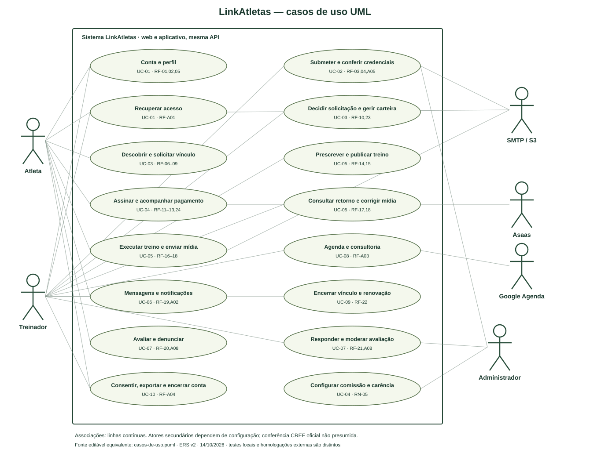

# Modelos atualizados da solução

Revisado em 20/10/2026. Fontes editáveis abaixo refletem API/migrations cumulativas e [ERS v2](ERS-v2.md). Modelo conceitual de classes não equivale à declaração de classes ORM: o backend usa módulos e SQL explícito. O adaptador contém as classes reais `AsaasClient` e `AsaasError`, identificadas no modelo.

| Modelo | Fonte | Visualização |
|---|---|---|
| Casos de uso UML | [PlantUML](diagramas/casos-de-uso.puml) | [SVG vetorial](diagramas/casos-de-uso.svg) |
| Classes conceituais | [Mermaid](diagramas/classes.mmd) | [PNG](diagramas/classes.png) |
| DER relacional | [Mermaid](diagramas/der.mmd) | [PNG](diagramas/der.png) / [SVG para ampliar](diagramas/der.svg) |
| Sequência contratação/financeiro | [Mermaid](diagramas/sequencia-contratacao.mmd) | [PNG](diagramas/sequencia-contratacao.png) |
| Sequência treino/mídia/chat | [Mermaid](diagramas/sequencia-treino.mmd) | [PNG](diagramas/sequencia-treino.png) |

O SVG de casos de uso usa atores, elipses de casos, associações e limite de sistema em notação UML, com fonte PlantUML equivalente. Substitui a limitação declarada do fluxograma Mermaid histórico, sem reclassificar retroativamente o diagrama antigo como UML formal.

DER resume atributos/chaves relevantes das 35 tabelas de domínio das migrations 001–005; `schema_migrations` é a 36ª tabela técnica registrada pelo executor. As 45 relações FK foram conferidas no PostgreSQL, incluindo referências opcionais a usuário, revisor, auditoria e documento. O [dicionário completo](dicionario-dados.md) registra 257 colunas, restrições e índices; [snapshot](evidencias/database-schema.json) e [exportador](../../scripts/export-schema.ts) permitem reproduzir a conferência. `pnpm docs:check` valida atributos/relações do DER e chamadas dos diagramas de sequência. Migration 005 garante correlação `provider_customer_id` e nulabilidade referencial da auditoria. Relações polimórficas `resource_id` de mídia/notificação e IDs de provedor/evento não são chaves estrangeiras relacionais; API os autoriza/concilia. `metric_types` valida JSON pelo servidor, sem FK de cada chave JSON.

O DER representa restrições físicas: por exemplo, um usuário pode ter zero ou um perfil no esquema relacional, enquanto o cadastro da aplicação cria ambos na mesma transação. O mínimo de um bloco por treino é validado pela aplicação; uma FK isolada não garante esse mínimo no banco. O modelo conceitual registra essas invariantes de domínio. Documento de verificação não tem unicidade global: várias submissões podem apontar para a mesma mídia autorizada.

Cardinalidades e regras: uma execução por ficha, uma avaliação por ciclo e uma assinatura por ciclo; contrato permite vários ciclos históricos e só um vigente por par via índice parcial. Documento de verificação é opcional; arquivo tem proprietário/finalidade/recurso. Saúde privada é opcional; consentimento tem chave por usuário/finalidade e histórico separado. Descrição de consultoria, mensagem, feedback, mídia e payload privado de execução são cifrados; não sugerir que o esquema inteiro ou campos públicos de reviews estão cifrados.
