# ERS v2.6 - LinkAtletas

1 Introdução	5

1.1 Objetivos deste documento	6

1.2 Escopo do produto	6

1.2.1 Nome do produto e componentes principais	6

1.2.2 Descrição do produto	7

1.2.3 Missão do produto	8

1.2.4 Tabela de viabilidade	8

1.2.5 Justificativa	11

1.3 Definições e siglas	13

1.4 Técnica(s) utilizada(s) para levantamento de requisitos	14

2. Requisitos Específicos	14

2.1 Requisitos Funcionais (RF)	14

2.2 Requisitos Não Funcionais (RNF)	30

2.3 Regras de Negócio (RN)	38

3. Cronograma do Projeto	40

3.1 Planejamento de Sprints	40

4. Protótipo do produto	44

5. Diagramas UML	48

5.1 Diagrama de Casos de Uso	48

5.1 Diagrama de Classes	49

5.2 Diagrama de Sequência	50

5.3 Diagrama de Atividade	56

5.4 DER	58

6. Casos de Testes	59

7. Apêndices	67

### 1.4 Técnica(s) utilizada(s) para levantamento de requisitos

As seguintes técnicas foram utilizadas:

•	Brainstorming

•	Observação do processo atual

•	Análise de sistemas similares

•	Prototipagem de Baixa Fidelidade

## 2. Requisitos Específicos

### 2.1 Requisitos Funcionais (RF)

Os requisitos abaixo descrevem a interação entre usuário e sistema. RF-01 a RF-24 mantêm a identificação original; RF-A01 a RF-A08 correspondem às funcionalidades complementares incorporadas na Sprint 2. A lista priorizada e o estado de implementação estão no backlog do projeto.

Os requisitos financeiros RF-11 a RF-13 e RF-24 possuem integração preparada e testes controlados. A demonstração acadêmica não realiza cobranças reais.

### [RF 01] – Cadastro e edição de perfil do atleta

**Descrição:** O sistema deve permitir que o atleta crie sua conta e mantenha atualizadas suas informações pessoais, localização e preferências esportivas para direcionamento na plataforma. Dados privados de saúde são opcionais e exigem consentimento específico.

**Ator Principal:** Atleta

**Pré-condições:** Visitante para criar conta; titular autenticado para manter o perfil.

**Fluxo Principal:**

1.	Informar nome, e-mail e senha; o servidor valida a entrada, cria conta e perfil e inicia sessão.

2.	Completar as preferências esportivas e salvar o perfil.

3.	O servidor valida as opções e persiste as alterações; a próxima busca usa os dados atuais.

**Fluxos Alternativos / Subfluxos:**

A1 - E-mail já cadastrado: impedir a criação de conta duplicada e informar o erro.

A2 - Campos inválidos: destacar a informação que precisa de correção e impedir a gravação até o ajuste.

### [RF 02] – Cadastro e edição de perfil do treinador

**Descrição:** O sistema deve permitir que o treinador cadastre e mantenha seu perfil profissional, incluindo nome, apresentação, cidade, modalidades, objetivos, níveis atendidos, disponibilidade, formato de atendimento e preço.

**Ator Principal:** Treinador

**Pré-condições:** Visitante para criar conta; treinador autenticado para editar o próprio perfil.

**Fluxo Principal:**

1.	Criar conta com papel treinador e acessar o perfil.

2.	Preencher os campos profissionais e salvar.

3.	O servidor valida e persiste; a publicação na descoberta depende da aprovação profissional vigente.

**Fluxos Alternativos / Subfluxos:**

A1 - Dados incompletos ou inválidos exigem correção.

A2 - Editar o perfil não concede aprovação de CREF.

### [RF 03] – Submissão de registro profissional

**Descrição:** O sistema deve permitir ao treinador submeter seu número de CREF e evidência textual para análise administrativa, com documento privado de imagem ou PDF opcional. O número deve ter de 4 a 50 caracteres e a evidência, de 10 a 2.000 caracteres.

**Ator Principal:** Treinador

**Pré-condições:** Conta autenticada e perfil com modalidade, nível, objetivos e disponibilidade preenchidos.

**Fluxo Principal:**

1.	Informar CREF e evidência; anexar documento próprio se necessário.

2.	O servidor valida formato, propriedade e finalidade do arquivo.

3.	Persistir a submissão pendente e disponibilizá-la à administração.

**Fluxos Alternativos / Subfluxos:**

A1 - Perfil incompleto, documento alheio ou perfil já aprovado geram erro.

A2 - Validade de formato não comprova regularidade no conselho.

### [RF 04] – Conferência manual do registro profissional

**Descrição:** O sistema deve permitir que o administrador registre a decisão sobre o registro profissional após consultar manualmente a fonte oficial do conselho e conferir CREF, titularidade e situação. A aplicação mantém a decisão, o responsável, o motivo e a validade administrativa.

**Ator Principal:** Administrador

**Pré-condições:** Submissão pendente e administrador autenticado.

**Fluxo Principal:**

1.	Abrir a submissão e conferir a fonte oficial.

2.	Registrar no motivo a fonte, a data e o resultado da conferência; a evidência enviada pelo treinador permanece distinta desse registro administrativo.

3.	Aprovar ou rejeitar com motivo de 5 a 1.000 caracteres; informar validade futura quando aplicável.

4.	O servidor grava decisão, revisor e auditoria na mesma transação e atualiza o perfil.

**Fluxos Alternativos / Subfluxos:**

A1 - Consulta indisponível ou dados insuficientes mantêm a análise pendente.

A2 - Divergência exige rejeição motivada e eventual nova submissão.

A3 - Decisão repetida é conflito.

A4 - Sem prazo explícito, aprovação usa 365 dias como validade administrativa padrão, não como validade oficial da cédula.

### [RF 05] – Autenticação e controle de acesso

**Descrição:** O sistema deve autenticar atletas, treinadores e administradores e restringir as operações conforme papel, propriedade do recurso e estado da conta. A web utiliza sessão em cookie HttpOnly; o aplicativo utiliza token Bearer opaco armazenado no SecureStore.

**Ator Principal:** Atleta, treinador e administrador

**Pré-condições:** Conta existente e ativa; administrador provisionado por procedimento próprio.

**Fluxo Principal:**

1.	Informar e-mail e senha; o servidor verifica a credencial e inicia sessão.

2.	Acessar funções permitidas ao papel e ao recurso solicitado.

3.	Ao sair, invalidar a sessão; a recuperação segue RF-A01.

**Fluxos Alternativos / Subfluxos:**

A1 - Credencial inválida, sessão expirada ou acesso indevido são negados.

A2 - O cadastro público não permite criar administrador.

### [RF 06] – Processamento de matchmaking por regras

**Descrição:** O sistema deve calcular a compatibilidade entre atleta e treinadores elegíveis por regras explicáveis. Após filtrar modalidade e atendimento/cidade, a pontuação considera objetivos (30), nível (20), orçamento (25) e horário em comum (25), somando até 100 pontos.

**Ator Principal:** Sistema, solicitado pelo atleta

**Pré-condições:** Atleta autenticado com preferências; profissionais aprovados e elegíveis.

**Fluxo Principal:**

1.	Consultar profissionais aprovados, ativos e com validade vigente.

2.	Excluir incompatíveis em modalidade e atendimento; quando presencial exigir cidade, excluir cidade incompatível ou ausente.

3.	Calcular score e razões; ordenar por score, nome e identificador para desempate.

**Fluxos Alternativos / Subfluxos:**

A1 - Sem candidatos: informar a ausência de resultados quando os filtros eliminarem os profissionais disponíveis.

A2 - Atendimento presencial incompatível: excluir candidatos cuja cidade seja incompatível ou não esteja informada.

### [RF 07] – Busca e filtragem de treinadores

**Descrição:** O sistema deve permitir ao atleta buscar treinadores por modalidade, texto, preço máximo e formato de atendimento. A busca textual deve considerar nome, cidade e apresentação profissional.

**Ator Principal:** Atleta

**Pré-condições:** Sessão válida.

**Fluxo Principal:**

1.	Abrir a descoberta e informar filtros disponíveis.

2.	O servidor aplica elegibilidade, matching e filtros.

3.	Exibir cards, score e razões; limpar filtros refaz a consulta.

**Fluxos Alternativos / Subfluxos:**

A1 - Entrada inválida gera erro; ausência de resultados permite revisar filtros.

A2 - Suspensão/expiração é verificada no servidor em nova consulta, sem garantia de atualização instantânea de toda lista já aberta.

### [RF 08] – Visualização do portfólio do treinador

**Descrição:** O sistema deve apresentar o portfólio do treinador com apresentação, modalidades, atendimento, cidade, preço, registro profissional, compatibilidade e avaliações publicadas, preservando a privacidade dos documentos e mídias restritos.

**Ator Principal:** Atleta

**Pré-condições:** Acesso autorizado à descoberta.

**Fluxo Principal:**

1.	Selecionar um profissional exibido na descoberta.

2.	Consultar os dados públicos e avaliações visíveis.

3.	Iniciar solicitação de vínculo se o profissional continuar elegível.

**Fluxos Alternativos / Subfluxos:**

A1 - Perfil indisponível ou inelegível: impedir a contratação e informar que o profissional não está disponível para um novo vínculo.

### [RF 09] – Solicitação de contratação e assinatura

**Descrição:** O sistema deve permitir ao atleta solicitar um vínculo com treinador elegível. A solicitação deve permanecer pendente até a decisão do profissional, antes de qualquer intenção financeira.

**Ator Principal:** Atleta

**Pré-condições:** Atleta autenticado e treinador elegível.

**Fluxo Principal:**

1.	Confirmar interesse no treinador.

2.	O servidor revalida elegibilidade e unicidade de ciclo vigente e persiste o pedido.

3.	Após o aceite, modo acadêmico mantém vínculo sem cobrança; modo Asaas configurado permite preparar checkout.

**Fluxos Alternativos / Subfluxos:**

A1 - Duplicidade, papel incorreto ou profissional inelegível geram erro.

A2 - Um ciclo anterior encerrado/recusado permite novo ciclo sem mover seu histórico.

### [RF 10] – Aceite ou recusa de solicitação de aluno

**Descrição:** O sistema deve permitir que o treinador aceite ou recuse exclusivamente as solicitações destinadas ao seu perfil, registrando a decisão e preservando o histórico do ciclo.

**Ator Principal:** Treinador destinatário

**Pré-condições:** Solicitação pendente e profissional elegível para aceitar.

**Fluxo Principal:**

1.	Consultar pedidos e perfil do solicitante.

2.	Aceitar ou recusar; o servidor bloqueia o registro e verifica o destinatário e estado.

3.	Atualizar vínculo/carteira. No modo financeiro, acesso depende da vigência aplicável.

**Fluxos Alternativos / Subfluxos:**

A1 - Terceiro não decide; concorrência ou nova decisão sobre pedido resolvido gera conflito.

A2 - Recusa não inicia cobrança nem reduz a nota do match.

### [RF 11] – Pagamento recorrente

**Descrição:** No modo financeiro configurado, o sistema deve preparar checkout hospedado e acompanhar a assinatura por eventos autenticados. O provedor gerencia a cobrança, sem transmitir dados brutos de cartão ao LinkAtletas.

**Ator Principal:** Atleta, sistema e Asaas configurado

**Pré-condições:** Ciclo aceito; modo Asaas, plano, carteira e credenciais configurados.

**Fluxo Principal:**

1.	Persistir intenção única e solicitar checkout recorrente ao provedor.

2.	Apresentar URL hospedada ao atleta.

3.	Receber webhook autenticado e persistir evento único.

4.	Processar evento e atualizar estado e vigência.

**Fluxos Alternativos / Subfluxos:**

A1 - Sem configuração não há sucesso externo.

A2 - Timeout mantém resultado incerto para conciliação; redirect não confirma pagamento.

A3 - Modo acadêmico não cobra.

### [RF 12] – Divisão de pagamento

**Descrição:** No modo financeiro configurado, o sistema deve solicitar ao provedor a divisão do pagamento entre a taxa da plataforma e a participação do treinador e registrar as referências e valores retornados.

**Ator Principal:** Sistema e provedor financeiro

**Pré-condições:** Carteira elegível, comissão configurada e modo Asaas.

**Fluxo Principal:**

1.	Ler carteira e comissão administrativa.

2.	Enviar a participação ao provedor no checkout.

3.	Processar eventos autenticados e registrar referências, valores e estados dos splits.

**Fluxos Alternativos / Subfluxos:**

A1 - Carteira/configuração inválida impede a operação; falha externa segue conciliação.

A2 - A aplicação não assume poder de reter ou liberar saldo bancário por conta própria.

### [RF 13] – Inadimplência e carência

**Descrição:** No modo financeiro configurado, o sistema deve acompanhar o estado do pagamento, o período pago e a carência definida, suspendendo novas interações quando a regra de acesso exigir.

**Ator Principal:** Sistema e jobs

**Pré-condições:** Assinatura financeira e eventos válidos.

**Fluxo Principal:**

1.	Registrar evento e preservar a vigência confirmada.

2.	Aplicar carência e conciliar pendências por jobs.

3.	Restaurar regularidade após confirmação ou bloquear novas ações ao terminar o prazo aplicável.

**Fluxos Alternativos / Subfluxos:**

A1 - Evento antigo não reduz período pago.

A2 - Criação de cobrança com resultado incerto não recebe repetição cega; histórico não é apagado por suspensão.

### [RF 14] – Prescrição de fichas de treino

**Descrição:** O sistema deve permitir ao treinador criar fichas de treino com modalidade, data e blocos de exercícios, orientações, metas e métricas, com ações explícitas de salvar rascunho e publicar.

**Ator Principal:** Treinador

**Pré-condições:** Ciclo ativo, aprovação profissional e acesso financeiro aplicável válidos.

**Fluxo Principal:**

1.	Selecionar o atleta do vínculo e preencher ficha/blocos.

2.	Salvar rascunho privado ou solicitar publicação.

3.	O servidor valida propriedade e catálogo e persiste; atleta consulta somente o publicado.

**Fluxos Alternativos / Subfluxos:**

A1 - Dados inválidos impedem gravação.

A2 - Terceiro não prescreve.

A3 - Encerramento efetivo impede novas prescrições; não significa apagar fichas históricas.

### [RF 15] – Orientação e mídia demonstrativa

**Descrição:** O sistema deve permitir ao treinador associar referências HTTPS aos blocos e mídias privadas de orientação à ficha, disponibilizando-as somente aos participantes autorizados.

**Ator Principal:** Treinador

**Pré-condições:** Ficha e vínculo autorizados.

**Fluxo Principal:**

1.	Informar referência HTTPS no bloco ou selecionar arquivo de orientação para a ficha.

2.	O servidor valida finalidade, arquivo e autorização.

3.	Armazenar mídia privada cifrada e permitir recuperação somente ao usuário autorizado.

**Fluxos Alternativos / Subfluxos:**

A1 - Arquivo inválido: recusar formato ou tamanho não permitido.

A2 - Acesso indevido: negar a associação ou leitura de mídia que não pertença ao usuário ou ao recurso autorizado.

### [RF 16] – Consulta de treinos prescritos

**Descrição:** O sistema deve permitir ao atleta consultar suas fichas publicadas, blocos de exercícios e referências de orientação, preservando o histórico conforme as regras de autorização do ciclo.

**Ator Principal:** Atleta

**Pré-condições:** Sessão válida e acesso autorizado ao vínculo/ficha.

**Fluxo Principal:**

1.	Abrir a área de treinos.

2.	Selecionar ficha publicada e consultar blocos, metas e orientação.

3.	Iniciar registro de execução pelo RF-17.

**Fluxos Alternativos / Subfluxos:**

A1 - Sem fichas publicadas, mostrar estado vazio.

A2 - Rascunho privado e ficha de terceiro não ficam acessíveis.

### [RF 17] – Registro de execução e feedback

**Descrição:** O sistema deve permitir ao atleta registrar os blocos realizados, métricas do catálogo, percepção de esforço de 1 a 10 e observações, mantendo uma execução por ficha e os dados privados cifrados.

**Ator Principal:** Atleta

**Pré-condições:** Ficha publicada autorizada e acesso válido.

**Fluxo Principal:**

1.	Marcar blocos concluídos e preencher métricas/esforço/observações.

2.	O servidor valida chaves, limites e índices e grava a execução.

3.	Atualização autorizada altera o mesmo registro; o treinador consulta o retorno.

**Fluxos Alternativos / Subfluxos:**

A1 - Execução parcial é permitida; métricas desconhecidas, fora da faixa ou blocos inexistentes são recusados.

### [RF 18] – Mídia de performance e correção técnica

**Descrição:** O sistema deve permitir ao atleta enviar mídia privada de performance e ao treinador autorizado registrar a correção técnica. Os arquivos devem respeitar tipo e finalidade, com limite de 50 MiB para vídeo e 10 MiB para os demais tipos permitidos. O cliente móvel utiliza seletor de arquivos; a implantação remota realiza upload em partes.

**Ator Principal:** Atleta e treinador do vínculo

**Pré-condições:** Recurso autorizado e consentimento específico de performance concedido.

**Fluxo Principal:**

1.	Selecionar arquivo e enviar para o recurso autorizado.

2.	Validar assinatura, MIME, extensão, tamanho, finalidade e consentimento; cifrar e armazenar.

3.	O treinador acessa o arquivo autorizado e registra correção técnica.

**Fluxos Alternativos / Subfluxos:**

A1 - Falha de envio mostra erro e permite nova ação do usuário, sem promessa de pausa/retomada automática.

A2 - Revogação de performance elimina as mídias abrangidas pela política.

### [RF 19] – Mensagens em tempo real

**Descrição:** O sistema deve permitir a troca de mensagens entre participantes autorizados de um vínculo, com histórico paginado e cifrado, registro de leitura, anexos privados e atualização por eventos quando conectados.

**Ator Principal:** Participantes do vínculo

**Pré-condições:** Sessão e vínculo válidos para envio.

**Fluxo Principal:**

1.	Abrir conversa e recuperar histórico persistido.

2.	Enviar texto/anexo autorizado; após commit o servidor publica para as partes.

3.	Confirmar leitura por cursor; reconexão consulta o banco novamente.

**Fluxos Alternativos / Subfluxos:**

A1 - Terceiro não acessa; vínculo encerrado não envia; sessão revogada fecha conexão.

A2 - Múltiplas instâncias precisam de broker futuro.

### [RF 20] – Avaliação pública do treinador

**Descrição:** O sistema deve permitir ao atleta elegível publicar nota de 1 a 5 e comentário sobre o treinador, com uma avaliação por ciclo, edição pelo autor e média calculada sobre o conteúdo visível.

**Ator Principal:** Atleta

**Pré-condições:** Vínculo elegível ativo há sete dias por padrão, conforme configuração.

**Fluxo Principal:**

1.	Selecionar vínculo elegível e preencher nota e comentário.

2.	Validar papel, vigência e período mínimo e persistir uma avaliação por ciclo.

3.	Exibir avaliações visíveis e sua média; autor pode editar conforme autorização.

**Fluxos Alternativos / Subfluxos:**

A1 - Avaliação não elegível: recusar envio antes do prazo mínimo, sem vínculo ativo ou por terceiro.

A2 - Duplicidade: impedir uma segunda avaliação para o mesmo ciclo.

### [RF 21] – Resposta a avaliações

**Descrição:** O sistema deve permitir ao treinador responder às avaliações do seu perfil, observando a visibilidade do conteúdo e o fluxo de denúncia e moderação descrito em RF-A08.

**Ator Principal:** Treinador avaliado

**Pré-condições:** Avaliação visível do próprio treinador.

**Fluxo Principal:**

1.	Consultar avaliações recebidas.

2.	Informar resposta e confirmar.

3.	O servidor verifica o treinador destinatário e vincula a resposta à avaliação.

**Fluxos Alternativos / Subfluxos:**

A1 - Outro profissional não responde; conteúdo oculto não recebe resposta pública.

A2 - Denúncia segue análise administrativa motivada.

### [RF 22] – Encerramento de vínculo e assinatura

**Descrição:** O sistema deve permitir a retirada de pedido pendente ou o encerramento do vínculo conforme seu estado. No modo acadêmico não há cobrança; no modo Asaas configurado, deve confirmar o cancelamento da renovação e preservar o período pago aplicável.

**Ator Principal:** Participante autorizado

**Pré-condições:** Ciclo acessível ao participante.

**Fluxo Principal:**

1.	Informar motivo e confirmar a operação.

2.	Autorizar o participante e bloquear o ciclo na transação.

3.	Aplicar encerramento acadêmico ou solicitar cancelamento ao provedor, preservando histórico e vigência confirmada.

**Fluxos Alternativos / Subfluxos:**

A1 - Repetição é idempotente; falha/timeout externo mantém pendência para conciliação, sem falso sucesso.

A2 - Suspensão profissional pode impedir novas ações independentemente de vigência financeira.

### [RF 23] – Gestão da carteira de alunos

**Descrição:** O sistema deve permitir ao treinador gerenciar suas solicitações e ciclos de acompanhamento, prescrever treinos, consultar execuções, trocar mensagens, agendar consultorias e acompanhar o estado financeiro aplicável.

**Ator Principal:** Treinador

**Pré-condições:** Treinador autenticado.

**Fluxo Principal:**

1.	Abrir carteira e selecionar o aluno/ciclo autorizado.

2.	Consultar estado e histórico e acessar ações permitidas.

3.	Ao encerrar, conservar registros e impedir novas operações incompatíveis com o estado.

**Fluxos Alternativos / Subfluxos:**

A1 - Encerramento preserva fichas existentes e histórico; não elimina automaticamente treinos futuros.

A2 - Terceiros não acessam a carteira.

### [RF 24] – Meio de pagamento no provedor

**Descrição:** No modo financeiro configurado, o sistema deve encaminhar o atleta ao checkout hospedado do provedor para gestão do pagamento, sem coletar ou armazenar número completo de cartão ou CVV.

**Ator Principal:** Atleta e provedor configurado

**Pré-condições:** Modo Asaas configurado e ciclo elegível.

**Fluxo Principal:**

1.	Preparar intenção e obter URL de checkout pelo fluxo financeiro.

2.	O atleta informa os dados somente no provedor.

3.	Atualizar assinatura por eventos autenticados e conciliação, não pelo redirect.

**Fluxos Alternativos / Subfluxos:**

A1 - Falta de configuração ou confirmação gera indisponibilidade/pendência.

A2 - Rejeição de cartão ocorre no ambiente externo e só é refletida conforme eventos realmente recebidos.

### [RF A01] – Recuperação de acesso por e-mail

**Descrição:** O sistema deve permitir a recuperação de senha por e-mail, utilizando token aleatório de uso único com expiração de 30 minutos, hash persistido e fila de envio SMTP.

**Ator Principal:** Titular da conta

**Pré-condições:** Acesso ao endereço cadastrado e serviço SMTP configurado.

**Fluxo Principal:**

1.	Solicitar recuperação por e-mail; devolver resposta genérica.

2.	Enviar link pelo SMTP; o titular informa token e nova senha.

3.	Verificar/bloquear token, alterar hash e revogar sessões anteriores.

**Fluxos Alternativos / Subfluxos:**

A1 - Token inválido: recusar tokens utilizados ou expirados.

A2 - Falha de envio: manter a tentativa na fila para processamento conforme a política de envio.

### [RF A02] – Notificações internas

**Descrição:** O sistema deve permitir consultar notificações internas, seu contador e estado de leitura, com marcação individual ou em lote e atualização por eventos quando conectado.

**Ator Principal:** Destinatário autenticado

**Pré-condições:** Evento persistido destinado ao usuário.

**Fluxo Principal:**

1.	Abrir a lista do destinatário.

2.	Consultar contador e marcar itens ou todos como lidos.

3.	Persistir leitura e atualizar a apresentação.

**Fluxos Alternativos / Subfluxos:**

A1 - Terceiro não lê nem marca notificações alheias.

A2 - Não há garantia de push de dispositivo fora do aplicativo.

### [RF A03] – Consultorias e agenda

**Descrição:** O sistema deve permitir criar, reagendar, cancelar e concluir consultorias, mantendo histórico e bloqueando sobreposição de horários. A agenda da aplicação deve funcionar independentemente da integração opcional com Google Calendar.

**Ator Principal:** Participante do vínculo; treinador para concluir

**Pré-condições:** Vínculo e acesso válidos; horário permitido.

**Fluxo Principal:**

1.	Definir início, duração e objetivo.

2.	Bloquear agendas em ordem e verificar conflito antes de persistir.

3.	Notificar as partes; registrar alterações motivadas e conclusão autorizada após o início.

**Fluxos Alternativos / Subfluxos:**

A1 - Terceiro, sobreposição, horário passado ou motivo ausente são recusados.

A2 - Integração Google é opcional, depende de OAuth e ação do treinador; sincronização bidirecional de alteração/cancelamento é futura.

### [RF A04] – Consentimento, exportação e encerramento de conta

**Descrição:** O sistema deve permitir gerenciar consentimentos por finalidade e versão, exportar os próprios dados e solicitar encerramento de conta, com anonimização ou remoção de conteúdo privado conforme política e retenção aplicáveis.

**Ator Principal:** Titular autenticado

**Pré-condições:** Conta ativa; senha confirmada para encerramento.

**Fluxo Principal:**

1.	Consultar política e conceder ou revogar consentimentos separados.

2.	Exportar os próprios dados quando solicitado.

3.	Confirmar senha para encerrar; conciliar financeiro, remover conteúdo abrangido, anonimizar e invalidar sessões.

**Fluxos Alternativos / Subfluxos:**

A1 - Senha incorreta ou pendência financeira/remoção não conciliada impede apresentar encerramento concluído.

A2 - Backups restaurados devem reaplicar pedidos de eliminação.

### [RF A05] – Validade e suspensão profissional

**Descrição:** O sistema deve controlar o prazo da aprovação profissional e permitir à administração suspender ou revogar a aprovação, registrando motivo e auditoria e retirando a elegibilidade para novas ações protegidas.

**Ator Principal:** Administrador e jobs

**Pré-condições:** Verificação existente e administrador autorizado para decisões manuais.

**Fluxo Principal:**

1.	Verificar prazo nos jobs ou receber decisão administrativa.

2.	Persistir alteração e auditoria.

3.	Negar descoberta e novas operações incompatíveis com a situação profissional.

**Fluxos Alternativos / Subfluxos:**

A1 - Uma tela já aberta precisa de nova consulta; não há promessa de atualização instantânea de todos os clientes.

A2 - Nova comprovação segue RF-03/04.

### [RF A06] – Aplicativo do atleta

**Descrição:** O sistema deve disponibilizar cliente React Native/Expo para o atleta, integrado à mesma API, com sessão no SecureStore e acesso a treinos, mensagens, agenda, mídias, notificações e privacidade.

**Ator Principal:** Atleta

**Pré-condições:** APK/perfil configurado e API acessível.

**Fluxo Principal:**

1.	Instalar o APK e conectar à API do ambiente configurado.

2.	Autenticar e executar funções autorizadas.

3.	Restaurar a sessão com segurança e tratar falhas de transporte.

**Fluxos Alternativos / Subfluxos:**

A1 - Perfil normal exige HTTPS; demonstração local restringe HTTP a loopback/emulador.

A2 - Bundle iOS não equivale a IPA, iPhone ou publicação em loja.

### [RF A07] – Operação e recuperação

**Descrição:** A operação deve permitir executar e configurar API, banco, SMTP e armazenamento, aplicar migrações e jobs e realizar procedimentos de backup e restauração. A implantação remota utiliza Vercel, Neon, Tigris, Brevo e cron-job.org; o ambiente local permanece independente.

**Ator Principal:** Responsável técnico

**Pré-condições:** Configuração, segredos e chave de cifra preservados.

**Fluxo Principal:**

1.	Preparar serviços/configuração e aplicar migrations sem apagar dados existentes.

2.	Iniciar aplicação e verificar saúde; agendar jobs conforme ambiente.

3.	Gerar backup com chave preservada e testar restauração isolada.

**Fluxos Alternativos / Subfluxos:**

A1 - Configuração inválida: impedir a operação externa e informar a falha sem expor segredos.

A2 - Recuperação: executar o procedimento documentado e conferir integridade e contagens; os ensaios realizados não substituem uma rotina recorrente de backup.

### [RF A08] – Moderação de avaliações

**Descrição:** O sistema deve permitir denunciar avaliações e à administração ocultar ou restaurar o conteúdo após análise, registrando decisão motivada e histórico.

**Ator Principal:** Usuário denunciante e administrador

**Pré-condições:** Avaliação existente; administrador autorizado para moderar.

**Fluxo Principal:**

1.	Registrar denúncia vinculada à avaliação.

2.	Administrador analisa e informa motivo da ocultação/restauração.

3.	Persistir decisão; média e listagem públicas usam somente conteúdo visível.

**Fluxos Alternativos / Subfluxos:**

A1 - Terceiro não altera avaliação; denúncia não é ocultação automática sem análise administrativa.

### 2.2 Requisitos Não Funcionais (RNF)

Os requisitos não funcionais definem qualidades e restrições técnicas. Os fluxos abaixo também orientam os cenários de verificação; os resultados executados estão na seção 6 e nos relatórios de testes.

### [RNF-01] – Conformidade com a LGPD

**Descrição:** A plataforma deve fornecer transparência sobre o tratamento de dados e exigir consentimento específico para dados sensíveis e mídia de performance. Os controles técnicos não equivalem a certificação jurídica de conformidade.

**Ator Principal:** Sistema / Usuário

**Pré-condições:** Acesso à política de privacidade e às funcionalidades que tratam dados pessoais.

**Fluxo Principal:**

1.	Consultar a política e as finalidades de tratamento.

2.	Conceder consentimento específico e registrar sua versão e data.

3.	Solicitar exportação dos próprios dados ou encerramento mediante reautenticação.

**Fluxos Alternativos / Subfluxos:**

A1 - Revogação: bloquear novos tratamentos da finalidade e remover dados ou mídias conforme a política.

A2 - Acesso de terceiros: negar exportação ou alteração de consentimento de outro usuário.

### [RNF-02] – Criptografia de Dados de Saúde e Biometria

**Descrição:** Dados sensíveis e arquivos privados devem ser protegidos em trânsito por HTTPS na implantação pública e cifrados em repouso pela aplicação com AES-256-GCM. Chaves permanecem somente no servidor.

**Ator Principal:** Sistema / Infraestrutura de Nuvem

**Pré-condições:** Transmissão ou gravação de informações sensíveis e mídia privada.

**Fluxo Principal:**

1.	Estabelecer comunicação HTTPS com a aplicação remota.

2.	Autorizar a operação e cifrar os campos sensíveis ou os bytes do arquivo antes da persistência.

3.	Conferir ausência de conteúdo em claro no banco e armazenamento e validar a recuperação autorizada.

**Fluxos Alternativos / Subfluxos:**

A1 - Integridade inválida: rejeitar conteúdo cuja autenticação criptográfica falhe.

A2 - Ambiente local: HTTP de desenvolvimento não comprova proteção de trânsito; testes TLS e HTTPS remoto têm evidências próprias.

### [RNF-03] – Trilha de Auditoria das Validações Profissionais

**Descrição:** O sistema deve registrar as decisões administrativas sobre o CREF, com responsável, data, motivo e validade, na mesma transação que altera o estado profissional. Não há consulta automática ao conselho nem imutabilidade contra administração direta do banco.

**Ator Principal:** Sistema / Administrador

**Pré-condições:** Submissão profissional pendente e administrador autenticado.

**Fluxo Principal:**

1.	O administrador confere registro, titularidade e situação na fonte oficial.

2.	Registra fonte, data e resultado no motivo da decisão.

3.	O sistema persiste decisão, revisor, prazo e auditoria em transação.

**Fluxos Alternativos / Subfluxos:**

A1 - Falha transacional: não concluir a mudança de estado sem gravar sua auditoria.

A2 - Fonte indisponível: manter a submissão pendente e retomar a conferência posteriormente.

### [RNF-04] – Restrição de Exibição de Perfil Não Validado

**Descrição:** Somente treinadores ativos, aprovados e com validade administrativa vigente podem aparecer na descoberta e receber novas solicitações de contratação.

**Ator Principal:** Sistema

**Pré-condições:** Consulta de treinadores ou solicitação de vínculo.

**Fluxo Principal:**

1.	Consultar a situação profissional no servidor.

2.	Excluir perfis pendentes, rejeitados, suspensos ou vencidos.

3.	Aplicar os filtros esportivos e apresentar os profissionais elegíveis.

**Fluxos Alternativos / Subfluxos:**

A1 - Mudança de situação: verificar novamente a elegibilidade em novas consultas e ações protegidas; uma lista já aberta precisa ser atualizada.

### [RNF-05] – Proteção de Dados de Cartão

**Descrição:** O LinkAtletas não deve coletar nem armazenar PAN ou CVV. O pagamento deve ocorrer em checkout hospedado pelo provedor. A integração foi testada com respostas controladas e não constitui certificação PCI-DSS ou homologação de cobrança real.

**Ator Principal:** Sistema / Gateway de Pagamentos

**Pré-condições:** Modo financeiro externo configurado; no modo acadêmico não há cobrança.

**Fluxo Principal:**

1.	Solicitar checkout somente após o aceite do vínculo.

2.	Receber a referência e URL do provedor e direcionar o usuário ao ambiente externo.

3.	Verificar que banco e logs mantêm somente referências necessárias, sem dados brutos de cartão.

**Fluxos Alternativos / Subfluxos:**

A1 - Modo acadêmico: manter a jornada esportiva sem operação financeira.

A2 - Falha do provedor: apresentar erro e preservar o estado financeiro para verificação segura.

### [RNF-06] – Desempenho do Algoritmo de Matchmaking

**Descrição:** A descoberta deve apresentar p95 de resposta de até dois segundos no cenário de carga definido. A medição local com base sintética não deve ser extrapolada para a produção.

**Ator Principal:** Sistema / Equipe de Testes

**Pré-condições:** Dataset, concorrência e ambiente de medição declarados.

**Fluxo Principal:**

1.	Preparar os perfis e preferências do cenário e aquecer a aplicação.

2.	Executar as consultas concorrentes de descoberta.

3.	Registrar respostas, erros, p50, p95 e p99 e comparar o p95 com o limite de dois segundos.

**Fluxos Alternativos / Subfluxos:**

A1 - Tempo excedido ou falha: registrar a ocorrência e investigar antes de aceitar o cenário. Não há entrega de recomendações antigas por cache no caminho testado.

### [RNF-07] – Modelo de Métricas por Modalidade

**Descrição:** Treinos e execuções devem utilizar métricas válidas para a modalidade, persistidas de forma extensível. A inclusão de esportes ou novas regras pode exigir alteração de contratos, código ou migração.

**Ator Principal:** Sistema / Treinador / Atleta

**Pré-condições:** Modalidade e catálogo de métricas disponíveis na versão da aplicação.

**Fluxo Principal:**

1.	Consultar os campos de métricas da modalidade escolhida.

2.	Preencher a ficha ou execução com valores e limites válidos.

3.	Validar as chaves e persistir o registro para posterior consulta.

**Fluxos Alternativos / Subfluxos:**

A1 - Chave desconhecida ou valor fora do limite: rejeitar a entrada e indicar a correção necessária.

### [RNF-08] – Escalabilidade da Base de Usuários

**Descrição:** A arquitetura deve permitir evolução da capacidade conforme o crescimento da base. A Sprint 2 utiliza Vercel, Neon e Tigris; a existência desses serviços não comprova autoescala da solução, balanceamento próprio ou disponibilidade ilimitada.

**Ator Principal:** Sistema / Equipe de Operação

**Pré-condições:** Ambiente de implantação identificado e carga de teste definida.

**Fluxo Principal:**

1.	Executar a carga no ambiente declarado e observar latência e erros.

2.	Conferir limites e métricas dos serviços de hospedagem, banco e armazenamento.

3.	Registrar o resultado e planejar ajustes de capacidade quando necessários.

**Fluxos Alternativos / Subfluxos:**

A1 - Limite de serviço atingido: tratar a falha e avaliar a capacidade antes de ampliar a operação. Autoescala por limiar de CPU e fila de processamento de vídeos são evoluções.

### [RNF-09] – Usabilidade do Aplicativo Mobile e Interface Responsiva

**Descrição:** A navegação deve permitir consultar recomendações, treinos e feedback com componentes legíveis. A web deve adaptar o conteúdo às larguras testadas sem rolagem horizontal indevida.

**Ator Principal:** Atleta / Sistema

**Pré-condições:** Cliente móvel instalado no ambiente de teste ou interface web aberta em viewport definido.

**Fluxo Principal:**

1.	Abrir a navegação e consultar as telas principais.

2.	Verificar a web nas larguras registradas no relatório e o cliente móvel no emulador Android.

3.	Confirmar acesso aos comandos e legibilidade do conteúdo.

**Fluxos Alternativos / Subfluxos:**

A1 - Falha de rede: exibir erro tratado e permitir retomar a operação.

A2 - Acessibilidade ampliada: validar separadamente fonte do sistema, leitor de tela e diretrizes nativas; esses ensaios não estão todos homologados.

### [RNF-10] – Usabilidade do Painel Web do Treinador

**Descrição:** O painel deve organizar a gestão de alunos, prescrição e publicação de treinos, permitindo salvar e reabrir rascunhos explicitamente. Autosave contínuo permanece evolução.

**Ator Principal:** Treinador / Sistema

**Pré-condições:** Treinador autenticado com vínculo autorizado.

**Fluxo Principal:**

1.	Acessar a carteira de alunos e selecionar o vínculo.

2.	Preencher uma ficha e salvar o rascunho.

3.	Reabrir o rascunho, conferir os dados e publicar a ficha.

**Fluxos Alternativos / Subfluxos:**

A1 - Validação inválida: manter o formulário e informar o campo que precisa de correção.

A2 - Falha ao salvar: não apresentar confirmação de sucesso antes da resposta do servidor.

### [RNF-11] – Feedback Visual em Fluxos Críticos

**Descrição:** As operações críticas devem informar espera, sucesso confirmado ou erro. Indicador de carregamento não equivale a porcentagem real de progresso nem comprova pagamento.

**Ator Principal:** Atleta / Treinador / Administrador

**Pré-condições:** Envio de formulário, documento ou arquivo, ou operação sujeita a espera.

**Fluxo Principal:**

1.	Acionar a operação e apresentar o estado de processamento.

2.	Aguardar a resposta do servidor, evitando submissões duplicadas.

3.	Exibir a confirmação apenas após o resultado positivo.

**Fluxos Alternativos / Subfluxos:**

A1 - Falha de validação ou rede: encerrar a espera, apresentar mensagem compreensível e permitir correção ou nova tentativa segura.

### [RNF-12] – Compatibilidade do Aplicativo Mobile

**Descrição:** O cliente móvel deve compilar e executar os fluxos suportados no Android testado. O suporte iOS, a execução em aparelho físico e a publicação nas lojas exigem homologações próprias.

**Ator Principal:** Atleta / Equipe de Testes

**Pré-condições:** APK compilado e ambiente Android de teste identificado.

**Fluxo Principal:**

1.	Compilar o APK e registrar versão, artefato e ambiente.

2.	Instalar e iniciar no emulador Android.

3.	Exercitar os fluxos previstos e registrar suas evidências, distinguindo ensaio integrado local e inicialização do APK com HTTPS.

**Fluxos Alternativos / Subfluxos:**

A1 - Ambiente não testado: registrar a limitação e executar a homologação específica antes de declarar compatibilidade.

### [RNF-13] – Compatibilidade de Navegadores no Painel Web

**Descrição:** A web deve funcionar nos cenários automatizados em Chromium, Firefox e WebKit, com interface responsiva. Esses engines não substituem homologação específica de Safari ou Edge reais.

**Ator Principal:** Usuário / Equipe de Testes

**Pré-condições:** Navegadores ou engines de teste identificados e aplicação disponível.

**Fluxo Principal:**

1.	Executar a jornada principal em cada engine definido.

2.	Verificar navegação, formulários, mensagens de erro e persistência.

3.	Registrar resultados, capturas e os limites da verificação de acessibilidade.

**Fluxos Alternativos / Subfluxos:**

A1 - Navegador ou recurso incompatível: registrar a falha e tratar o problema antes de declarar o cenário aprovado.

### [RNF-14] – Arquitetura de APIs Preparada para Integrações

**Descrição:** O backend deve expor rotas HTTP com dados JSON, schemas de validação e documentação OpenAPI, compartilhadas entre web e cliente móvel. Integrações com wearables permanecem evolução.

**Ator Principal:** Sistema / Desenvolvedor

**Pré-condições:** API disponível e contrato OpenAPI da mesma versão.

**Fluxo Principal:**

1.	Consultar o contrato OpenAPI e a documentação Swagger.

2.	Enviar requisição autenticada com os campos válidos.

3.	Validar a resposta e consultar a persistência quando aplicável.

**Fluxos Alternativos / Subfluxos:**

A1 - Payload incompatível: retornar erro de validação, sem persistir dados inválidos.

A2 - CREF: usar as rotas internas de submissão e decisão manual; não existe API externa do conselho integrada.

### [RNF-15] – Idempotência e Reconciliação Financeira

**Descrição:** O módulo financeiro deve evitar processamento local duplicado de eventos e preservar resultados incertos para reconciliação. O adaptador não garante idempotência externa do provedor; cobrança real não foi homologada.

**Ator Principal:** Sistema / Gateway de Pagamentos / Agendador

**Pré-condições:** Integração financeira configurada ou cenário de teste controlado.

**Fluxo Principal:**

1.	Registrar a intenção financeira e controlar concorrência e unicidade no banco.

2.	Receber o evento autenticado e impedir seu processamento local repetido.

3.	Processar os jobs pendentes e reconciliar referências incertas sem repetir cegamente a criação externa.

**Fluxos Alternativos / Subfluxos:**

A1 - Timeout: manter o resultado incerto para consulta segura.

A2 - Agendador indisponível: manter o job pendente; cron-job.org aciona a rota protegida, mas sua ativação não homologa a conta de pagamentos.

### [RNF-16] – Logging e Diagnóstico sem Exposição de Dados Sensíveis

**Descrição:** O sistema deve registrar informações técnicas de diagnóstico sem expor senhas, tokens, dados de saúde ou conteúdo de arquivos privados nos logs públicos.

**Ator Principal:** Sistema / Equipe de Operação

**Pré-condições:** Ocorrência de eventos técnicos ou erros na API.

**Fluxo Principal:**

1.	Registrar a ocorrência com os metadados técnicos necessários.

2.	Aplicar a sanitização aos campos sensíveis.

3.	Conferir nos testes que os marcadores sensíveis não aparecem nos registros observados.

**Fluxos Alternativos / Subfluxos:**

A1 - Erro com dados sensíveis: omitir ou mascarar o conteúdo antes da gravação. Monitoramento e auditoria independentes permanecem atividades de operação.

### 2.3 Regras de Negócio (RN)

As Regras de Negócio definem as restrições lógicas e os processos que o software deve obedecer obrigatoriamente.

**RN-01:** Somente treinador aprovado/elegível aparece na descoberta

**RN-02:** Administrador confere registro, titularidade e situação na fonte oficial e inclui fonte/data/resultado no motivo. Decisão e auditoria registram revisor, horário, origem manual e prazo: futuro explícito ou 365 dias administrativos por padrão na aprovação. Documento do treinador é opcional; evidence da submissão não é campo separado da conferência administrativa. Formato do número não comprova habilitação

**RN-03:** Expiração, suspensão e revogação retiram visibilidade e bloqueiam novas ações protegidas

**RN-04:** Mensalidade em modo Asaas solicita split para carteira elegível; só evento autenticado confirma estado financeiro

**RN-05:** Administrador configura comissão 0–50% (basis points) e carência 0–30 dias

**RN-06:** Pendência financeira mantém jobs/eventos e conciliação; carência vencida bloqueia novas interações; resultado incerto não é reemitido cegamente

**RN-07:** Eventos/chaves de provedor únicos, intenção única por ciclo e lock transacional impedem duplicação local

**RN-08:** Match considera modalidade, nível, objetivos, orçamento e horários, com razões explícitas

**RN-09:** Disponibilidade compõe pontuação; não reserva agenda. Recusa não reduz nota. Esta é mudança documentada da redação original

**RN-10:** Solicitação/decisão e interações persistem; treinamento/retroalimentação automática do match permanece futuro

**RN-11:** Novas prescrições exigem ciclo ativo e acesso profissional/financeiro válido

**RN-12:** Métricas respeitam chave, unidade e limites da modalidade; execução é única por ficha

**RN-13:** Avaliação exige vínculo ativo há sete dias por padrão; uma por ciclo; alteração da configuração precisa ser explicitada

**RN-14:** Saúde e performance exigem consentimento separado e finalidade, com revogação registrada

**RN-15:** Conteúdo privado utiliza AES-256-GCM em repouso e HTTPS na implantação configurada; chave fora do Git e preservada no backup

**RN-16:** Cartão bruto não é coletado/armazenado pela aplicação; meio de pagamento gerenciado pelo checkout hospedado

## 3. Cronograma do Projeto

O desenvolvimento do sistema LinkAtletas é conduzido por uma abordagem ágil, com entregas contínuas e alinhamento às necessidades de atletas, treinadores e administradores. As atividades abrangem levantamento de requisitos, prototipação, modelagem, implementação do fluxo esportivo, segurança e evolução da solução.

### 3.1 Planejamento de Sprints

A execução segue o planejamento por sprints do calendário acadêmico, com encerramento previsto em 30 de novembro de 2026. Os períodos abaixo consideram as janelas de entrega do roteiro dos professores. Funcionalidades complementares da Sprint 3 antecipadas na Sprint 2 continuam sujeitas à estabilização e às dependências externas indicadas no backlog.

• Sprint 01 — 03 de agosto a 14 de setembro de 2026: Planejamento, Requisitos e Modelagem

○	Elaboração do documento inicial da demanda, com evidência de atividade na plataforma SAGA.

○	Criação da ERS com requisitos funcionais, requisitos não funcionais e regras de negócio.

○	Estruturação da lista priorizada e dos cenários textuais de verificação de todos os requisitos não funcionais.

○	Especificação dos fluxos principais, alternativos, subfluxos e exceções dos requisitos funcionais.

○	Modelagem de casos de uso, classes e Diagrama Entidade-Relacionamento (DER).

○	Produção dos diagramas de sequência dos processos principais da solução.

○	Prototipação das três principais interfaces e mapeamento da navegação, com as referências do projeto no Stitch.

○	Preenchimento da matriz de integração das unidades curriculares.

○	Criação do repositório Git, README e organização inicial de pastas.

• Sprint 02 — 21 de setembro a 26 de outubro de 2026: Fluxo Principal, Validações e Banco de Dados

○	Atualização e versionamento do código-fonte no repositório do grupo.

○	Desenvolvimento da autenticação, controle de acesso por papel e propriedade e controles de privacidade (RF-05, RNF-01 e RNF-02).

○	Implementação dos cadastros de atleta e treinador, submissão de CREF e conferência manual administrativa na fonte oficial, com decisão e auditoria (RF-01 a RF-04, RNF-03 e RNF-04).

○	Desenvolvimento do matchmaking por regras explicáveis, busca e consulta do portfólio do treinador (RF-06 a RF-08, RNF-06).

○	Criação, migração e integração do PostgreSQL, incluindo catálogo de métricas e persistência das operações esportivas (RNF-07).

○	Integração da interface web responsiva e do cliente móvel à API para contratação, aceite, prescrição, publicação, execução e feedback de treinos (RF-09, RF-10, RF-14, RF-16 e RF-17).

○	Aplicação de validações de entrada, tratamento de falhas e feedback visual nos fluxos principais (RNF-11 a RNF-13).

○	Execução dos testes iniciais de API, interface e cliente móvel, com relatórios e capturas de evidência.

○	Documentação da API REST em OpenAPI e interface Swagger, incluindo as rotas internas de conferência manual do CREF (RNF-14).

○	Atualização da ERS, diagramas, backlog e registro de dificuldades, decisões e mudanças de escopo.

○	Implantação da web e API na Vercel, PostgreSQL no Neon, arquivos privados no Tigris, SMTP no Brevo e execução de tarefas pelo cron-job.org, com ambientes separados e testes remotos.

○	Antecipação de comunicação, agenda, avaliações, mídia privada, recuperação de senha e rotinas de privacidade, mantendo o modo financeiro acadêmico sem cobrança real.

• Sprint 03 — 09 a 30 de novembro de 2026: Estabilização do MVP e Entrega Final

○	Consolidação do MVP funcional e estável, revisão das pendências e estabilização dos módulos antecipados na Sprint 2.

○	Evolução e homologação externa do módulo financeiro, quando disponíveis os acessos: pagamentos recorrentes, split, inadimplência e reconciliação (RF-11 a RF-13, RF-24, RNF-05 e RNF-15).

○	Aperfeiçoamento do envio e correção de vídeos, chat, avaliações e acompanhamento de resultados (RF-15 e RF-18 a RF-23).

○	Consolidação das rotinas administrativas, suspensão de contas, configuração de taxas, auditoria e moderação (RF-A07 e RF-A08).

○	Finalização do código-fonte versionado, ERS final e documentação da API.

○	Atualização final dos diagramas UML e DER, coerentes com a solução implementada.

○	Execução da bateria final de testes, com relatório e evidências.

○	Finalização da matriz de rastreabilidade das unidades curriculares.

○	Revisão do manual de instalação, implantação e execução, acompanhado do README.

○	Consolidação do backlog final com itens concluídos, retirados e futuros.

○	Registro das limitações e propostas de evolução, incluindo homologação em aparelho físico, iOS e distribuição em lojas.

○	Preparação da apresentação da Mostra e das evidências de participação individual.

### Cronograma visual do projeto

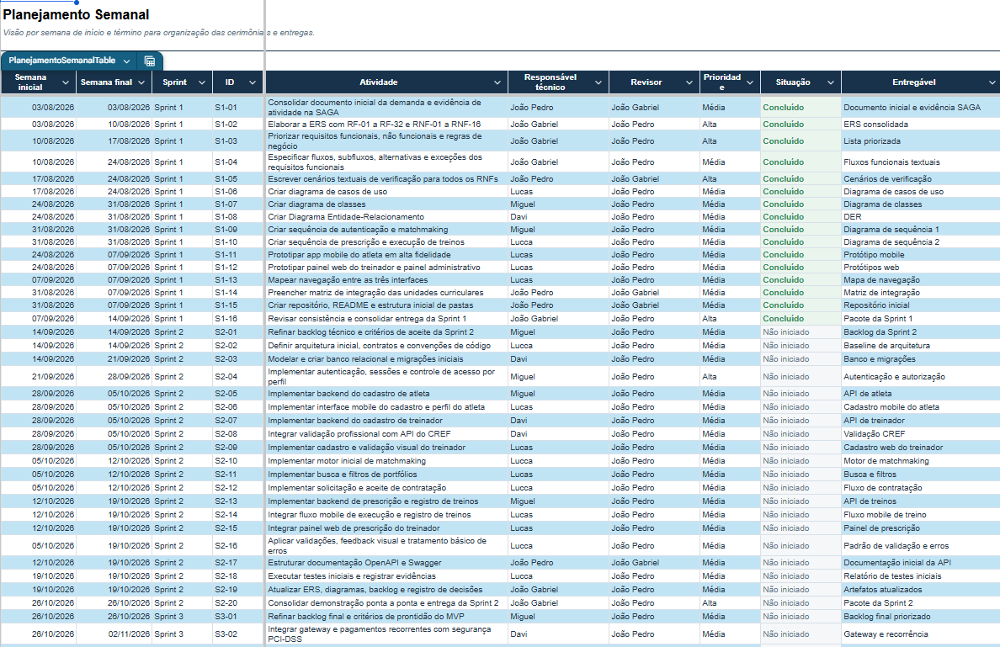

Fonte: Planejamento inicial do grupo (2026). As janelas de entrega atualizadas constam na seção 3.1; o quadro preserva a distribuição de atividades do planejamento original.

[Cronograma_Projeto_Integrador_LinkAtletas](https://docs.google.com/spreadsheets/d/18kTcqvdJ6_N9GXlvMkq4oABQzUAYpMNSPXozn0HHt14/edit?usp=sharing)

[Backlog atualizado do projeto](https://github.com/DaviSouza78/LinkAtletas/blob/main/docs/evolucao/requisitos/backlog.md)

## 4. Protótipo do produto

Nesta seção, apresentam-se as interfaces de alta fidelidade elaboradas pelo grupo para orientar o desenvolvimento do Front-end. Os protótipos preservam a concepção original; as evidências da interface implementada e integrada estão no relatório de testes.

**Link para o Protótipo:**

[Atleta — protótipo no Stitch](https://stitch.withgoogle.com/projects/8385490830921443646?pli=1)

[Treinador — protótipo no Stitch](https://stitch.withgoogle.com/projects/17299066006957473062)

**Principais Telas:**

### Tela principal mobile (atleta)

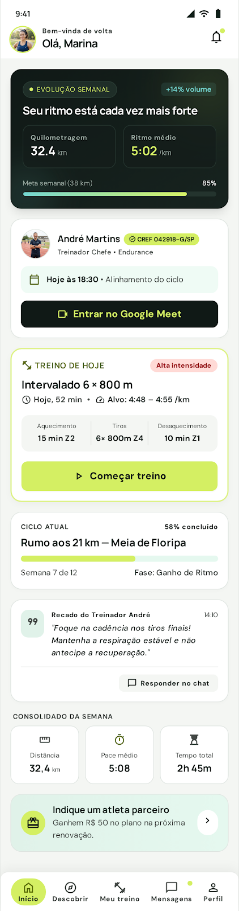

Fonte: Elaboração Própria (2026).

### Tela principal Web (treinador)

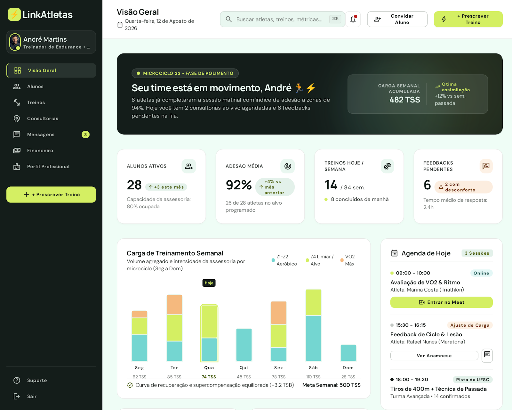

Fonte: Elaboração Própria (2026).

### Tela de consultoria e alinhamentos (treinador)

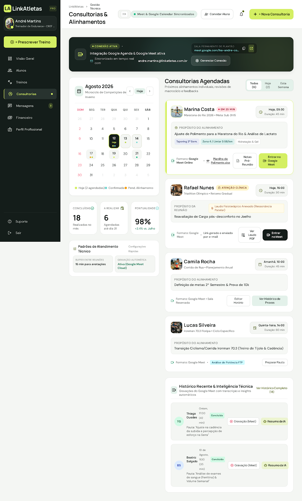

Fonte: Elaboração Própria (2026).

## 5. Diagramas UML

### 5.1 Diagrama de Casos de Uso

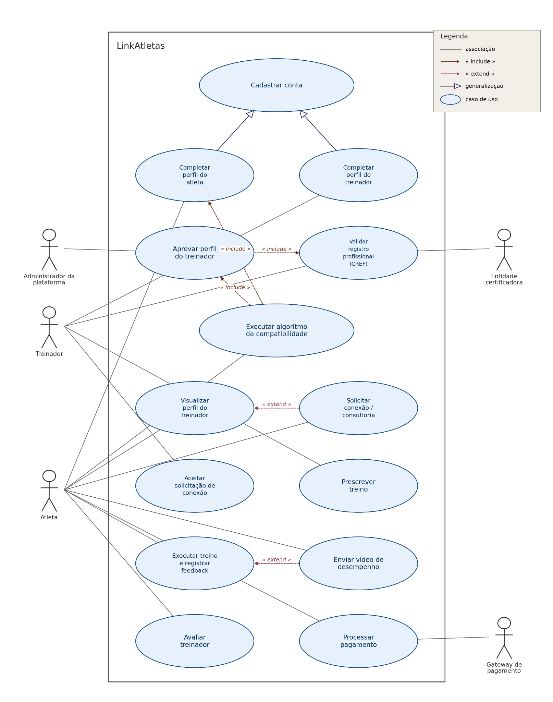

O atleta gerencia seu perfil, busca treinadores, solicita contratação, consulta e executa treinos e envia feedback. O treinador administra seu perfil, aceita vínculos e prescreve treinos. O administrador confere os registros profissionais e administra a plataforma. A entidade certificadora representa a fonte oficial consultada manualmente pelo administrador, sem chamada automática a uma API do conselho. O gateway representa o modo financeiro condicionado à configuração externa.

Fonte: Elaboração Própria (2026).

### 5.1 Diagrama de Classes

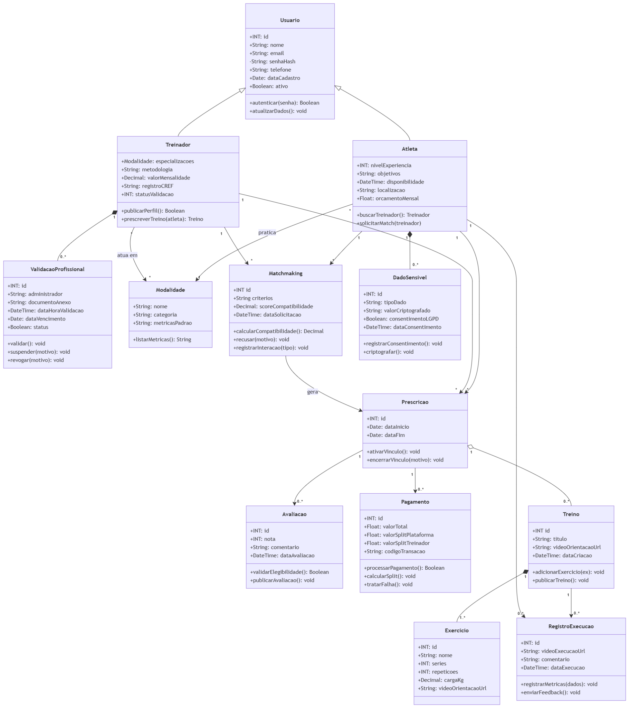

O modelo conceitual relaciona usuário, atleta, treinador, modalidade, validação profissional, matchmaking, prescrição, treino, exercícios, execução, avaliação e pagamento. A validação profissional é executada pela administração. Classes e operações descrevem o domínio; a implementação utiliza serviços e tabelas PostgreSQL, cujo esquema atualizado é apresentado no DER. O módulo financeiro permanece acadêmico nesta entrega.

Fonte: Elaboração Própria (2026).

### 5.2 Diagrama de Sequência

Os seis diagramas detalham os processos da Sprint 2. As duas sequências de contratação e treino mantêm as versões atualizadas aprovadas pela equipe.

### 5.2.1 Diagrama de Sequência [RF 09 e RF 10] — Contratação e aceite

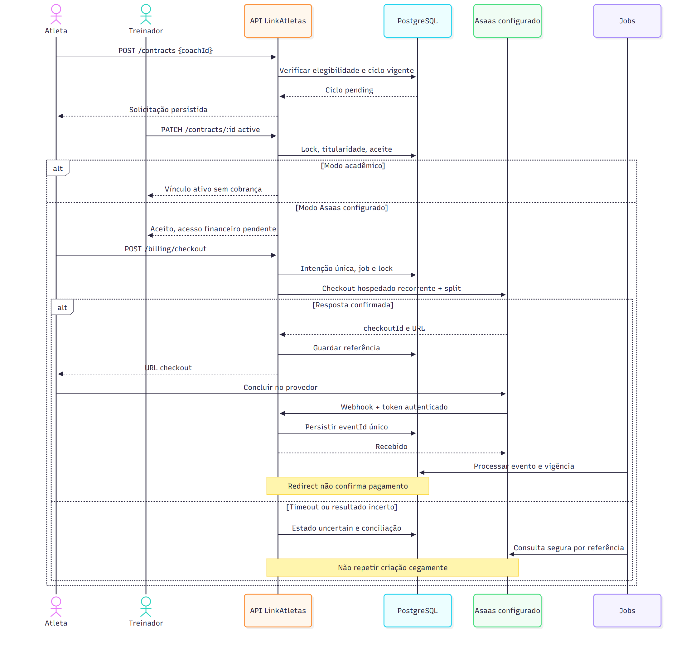

Solicitação de vínculo, aceite do treinador e distinção entre modo acadêmico e integração financeira configurada.

### 5.2.2 Diagrama de Sequência [RF 14 a RF 18] — Gestão do treino e correção técnica

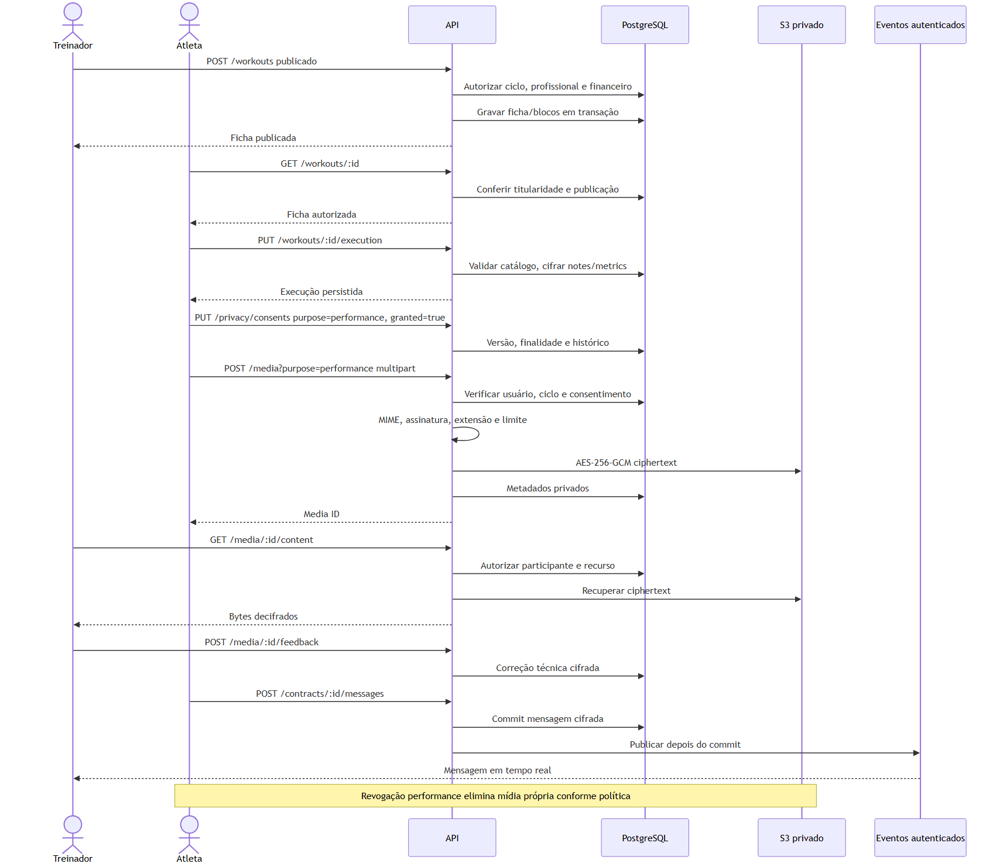

Prescrição, publicação, consulta autorizada, execução, feedback e mídia privada.

### 5.2.3 Diagrama de Sequência [RF 05] — Autenticação e sessão

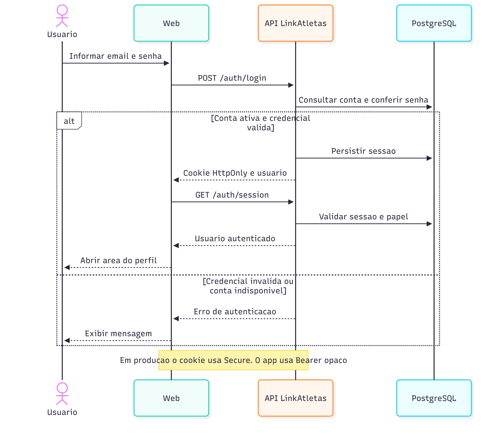

Validação das credenciais, emissão de sessão e consulta autorizada do usuário autenticado.

### 5.2.4 Diagrama de Sequência [RF 03 e RF 04] — Conferência manual do CREF

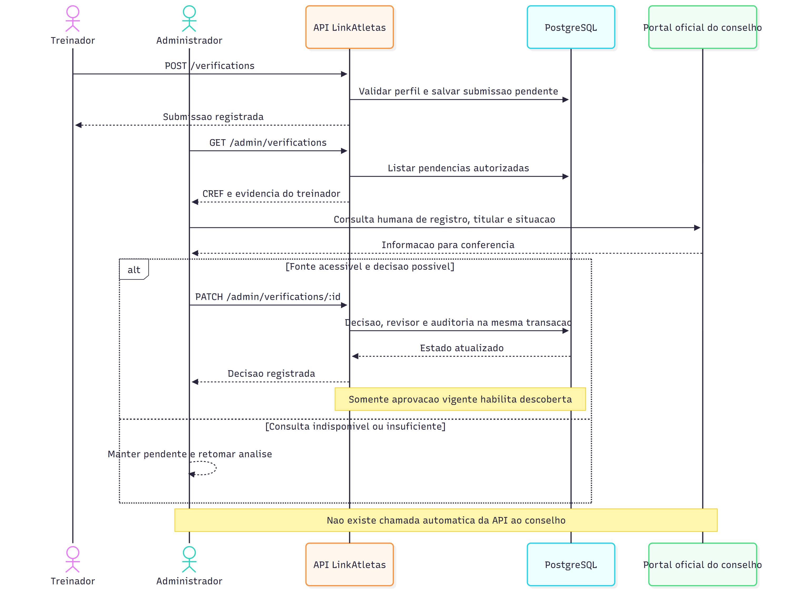

Submissão pelo treinador, consulta humana à fonte oficial, decisão administrativa e auditoria transacional.

### 5.2.5 Diagrama de Sequência [RF-A01] — Recuperação de senha

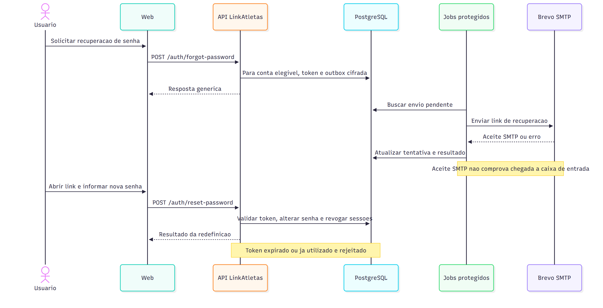

Solicitação com resposta genérica, outbox cifrada, envio SMTP e redefinição com token de uso único.

### 5.2.6 Diagrama de Sequência [RF 18] — Arquivo privado na nuvem

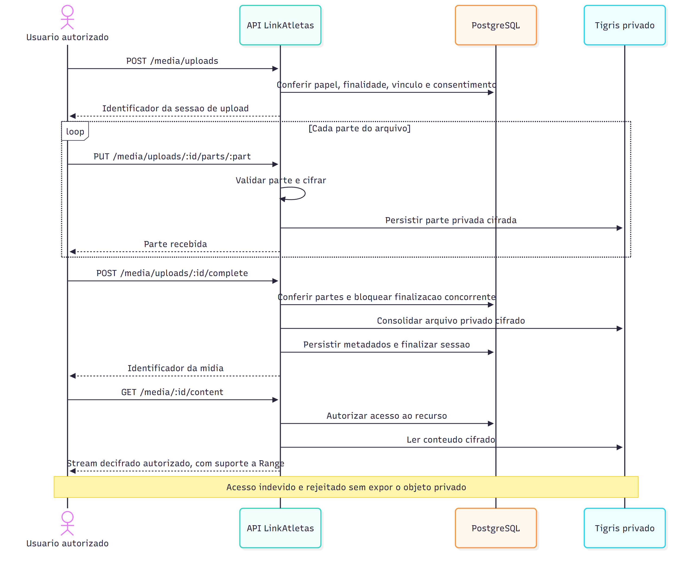

Upload em partes, autorização, cifra, finalização e download privado com controle de acesso.

### 5.3 Diagrama de Atividade

Os diagramas apresentam as decisões e os caminhos dos processos de validação profissional e acompanhamento esportivo.

### 5.3.1 Diagrama de Atividade [RF 03 e RF 04] — Validação profissional

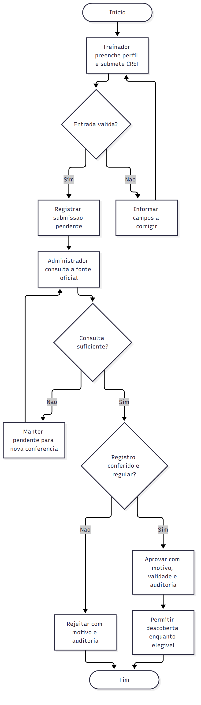

Análise manual com aprovação, rejeição ou manutenção da pendência quando não for possível concluir a conferência.

### 5.3.2 Diagrama de Atividade [RF 09 a RF 17] — Acompanhamento esportivo

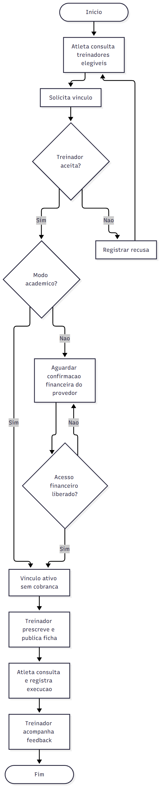

Da descoberta de um treinador elegível ao aceite, prescrição, execução e acompanhamento do feedback.

### 5.4 DER

O modelo representa as 37 tabelas do esquema PostgreSQL exportado. O banco remoto utiliza Neon; o banco Docker é independente. A figura apresenta atributos selecionados; os campos, índices e restrições completos estão no dicionário de dados.

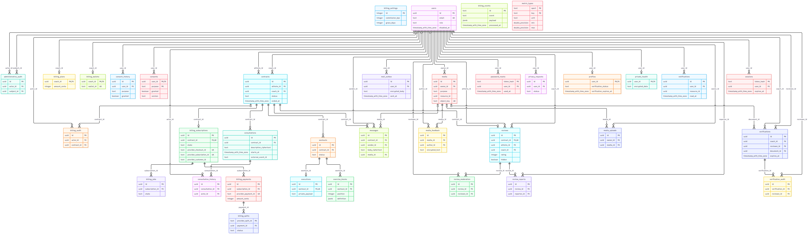

[DER vetorial ampliável](https://github.com/DaviSouza78/LinkAtletas/blob/main/docs/evolucao/diagramas/der.svg)

[Dicionário de dados e relacionamentos](https://github.com/DaviSouza78/LinkAtletas/blob/main/docs/evolucao/banco/dicionario-dados.md)

## 6. Casos de Testes

Os casos a seguir registram os testes iniciais exigidos na Sprint 2, com dados fictícios, resultados esperados, resultados observados e referências das evidências. Os relatórios distinguem execução local, Preview e produção. Esta revisão documental não representa uma nova execução de todos os testes.

Na etapa de implantação de 26/10/2026 foram aprovados 99 testes de API/unidade, 15 cenários de interface em Chromium, Firefox e WebKit e 22 testes do cliente móvel. O ensaio anterior do APK registrou 18 etapas integradas em emulador; o APK configurado para HTTPS também foi compilado, instalado e iniciado. Não houve homologação em aparelho físico, iOS, lojas ou cobrança real.

A jornada principal foi exercitada em Preview por HTTPS, com CREF manual, vínculo, prescrição, execução, feedback e mensagens. Em produção foram conferidos saúde da API/PostgreSQL, sessão, permissões, armazenamento privado e recuperação de senha com aceite SMTP. O aceite SMTP não comprova chegada à caixa de entrada. Os CT abaixo mantêm as datas e evidências das execuções que os sustentam.

[Relatório de testes e evidências](https://github.com/DaviSouza78/LinkAtletas/blob/main/docs/evolucao/relatorio-testes.md)

[Implantação e testes remotos de 26/10/2026](https://github.com/DaviSouza78/LinkAtletas/blob/main/docs/evolucao/operacao/implantacao-2026-10-26.md)

### CT001 – Cadastro de usuário atleta válido

**Rastreabilidade:** RF-01, RF-A06

**Pré-condições:** APK local instalado no emulador e serviços de teste disponíveis; conta fictícia nova.

**Fluxo de Teste:**

1.	Abrir cadastro como atleta e informar dados válidos.

2.	Confirmar o envio e consultar o usuário persistido no servidor.

**Resultado esperado:** Conta de atleta persistida e acesso iniciado, sem criar administrador.

**Resultado observado:** Aprovado no registro preservado: Cadastro pelo APK persistido no PostgreSQL.

**Data e ambiente:** 21/10/2026; CI Linux, emulador Android API 35 x86_64 e API/PostgreSQL/SMTP/S3 locais reais. Dados fictícios; sem aparelho físico ou financeiro externo.

[Evidência CT001](https://github.com/DaviSouza78/LinkAtletas/blob/main/docs/evolucao/evidencias/android/android-integrated-result.json)

### CT002 – Cadastro e perfil de treinador válido

**Rastreabilidade:** RF-02, RF-03, RF-05

**Pré-condições:** Treinador fictício criado pelo cadastro público na preparação da suíte de API.

**Fluxo de Teste:**

1.	Completar o perfil do treinador com as opções do catálogo.

2.	Exercitar validações de perfil e tentativa de decisão de CREF pelo papel atleta.

**Resultado esperado:** Preparação do cadastro/perfil concluída; dados inválidos e decisão pelo atleta são negados.

**Resultado observado:** Aprovado no registro preservado: valida perfil e não permite a atleta aprovar CREF.

**Data e ambiente:** 21/10/2026 14:36:01 UTC-03:00. Windows, API Fastify/PostgreSQL e serviços locais; dados fictícios. Data derivada do startTime do arquivo Vitest, preservado sem reexecução.

[Evidência CT002](https://github.com/DaviSouza78/LinkAtletas/blob/main/docs/evolucao/evidencias/api/vitest-results.json)

### CT003 – Credencial inválida e unicidade de e-mail

**Rastreabilidade:** RF-01, RF-05, RNF-11

**Pré-condições:** Conta fictícia já cadastrada.

**Fluxo de Teste:**

1.	Tentar cadastro com o mesmo e-mail variando maiúsculas/minúsculas.

2.	Tentar autenticar com senha incorreta.

**Resultado esperado:** Duplicidade e login inválido são recusados com tratamento de erro.

**Resultado observado:** Aprovado no registro preservado: impede e-mail duplicado sem distinguir maiúsculas e senha incorreta.

**Data e ambiente:** 21/10/2026 14:36:01 UTC-03:00. Windows, API Fastify/PostgreSQL e serviços locais; dados fictícios. Data derivada do startTime do arquivo Vitest, preservado sem reexecução.

[Evidência CT003](https://github.com/DaviSouza78/LinkAtletas/blob/main/docs/evolucao/evidencias/api/vitest-results.json)

### CT004 – Conferência manual e auditoria de CREF

**Rastreabilidade:** RF-03, RF-04, RN-01, RN-02, RNF-03

**Pré-condições:** Treinador com perfil completo, submissão fictícia e administrador de teste.

**Fluxo de Teste:**

1.	Submeter comprovação de teste.

2.	Administrador aprova pela API com motivo.

3.	Conferir decisão e auditoria persistidas.

**Resultado esperado:** Decisão administrativa rastreável atualiza o perfil. O teste não consulta nem comprova registro profissional real.

**Resultado observado:** Aprovado no registro preservado: submete comprovação e registra aprovação administrativa com auditoria.

**Data e ambiente:** 21/10/2026 14:36:01 UTC-03:00. Windows, API Fastify/PostgreSQL e serviços locais; dados fictícios. Data derivada do startTime do arquivo Vitest, preservado sem reexecução.

[Evidência CT004](https://github.com/DaviSouza78/LinkAtletas/blob/main/docs/evolucao/evidencias/api/vitest-results.json)

### CT005 – Profissional pendente fora da descoberta

**Rastreabilidade:** RF-04, RF-06, RNF-04

**Pré-condições:** Treinador fictício ainda não aprovado e atleta autenticado.

**Fluxo de Teste:**

1.	Consultar descoberta.

2.	Tentar contratar diretamente o profissional pendente.

**Resultado esperado:** Profissional não aparece e a contratação direta é impedida.

**Resultado observado:** Aprovado no registro preservado: oculta treinador ainda não aprovado e impede sua contratação.

**Data e ambiente:** 21/10/2026 14:36:01 UTC-03:00. Windows, API Fastify/PostgreSQL e serviços locais; dados fictícios. Data derivada do startTime do arquivo Vitest, preservado sem reexecução.

[Evidência CT005](https://github.com/DaviSouza78/LinkAtletas/blob/main/docs/evolucao/evidencias/api/vitest-results.json)

### CT006 – Matching calculado e filtros suportados

**Rastreabilidade:** RF-06, RF-07, RN-08, RN-09

**Pré-condições:** Perfis fictícios com preferências e profissional aprovado.

**Fluxo de Teste:**

1.	Consultar a recomendação e conferir score/razões.

2.	Aplicar os filtros implementados e comparar a resposta.

**Resultado esperado:** Ranking respeita pontuação e filtros; não se presume filtro por nota média.

**Resultado observado:** Aprovado no registro preservado: retorna recomendação calculada e respeita filtros.

**Data e ambiente:** 21/10/2026 14:36:01 UTC-03:00. Windows, API Fastify/PostgreSQL e serviços locais; dados fictícios. Data derivada do startTime do arquivo Vitest, preservado sem reexecução.

[Evidência CT006](https://github.com/DaviSouza78/LinkAtletas/blob/main/docs/evolucao/evidencias/api/vitest-results.json)

### CT007 – Solicitação, duplicidade e acesso por terceiro

**Rastreabilidade:** RF-09, RF-10, RN-07

**Pré-condições:** Atleta e treinador elegíveis; outro usuário de teste.

**Fluxo de Teste:**

1.	Criar solicitação pendente.

2.	Repetir a solicitação e tentar decidir com terceiro.

**Resultado esperado:** Pedido inicial persiste; duplicidade e decisão por terceiro são negadas.

**Resultado observado:** Aprovado no registro preservado: cria solicitação pendente, bloqueia duplicata e aceite por terceiros.

**Data e ambiente:** 21/10/2026 14:36:01 UTC-03:00. Windows, API Fastify/PostgreSQL e serviços locais; dados fictícios. Data derivada do startTime do arquivo Vitest, preservado sem reexecução.

[Evidência CT007](https://github.com/DaviSouza78/LinkAtletas/blob/main/docs/evolucao/evidencias/api/vitest-results.json)

### CT008 – Aceite concorrente de solicitação

**Rastreabilidade:** RF-10, RN-07

**Pré-condições:** Solicitação pendente destinada ao treinador autenticado.

**Fluxo de Teste:**

1.	Enviar decisões simultâneas para a mesma solicitação.

2.	Consultar o estado final.

**Resultado esperado:** Somente uma decisão efetiva; não são criados ciclos duplicados.

**Resultado observado:** Aprovado no registro preservado: aceita uma única vez mesmo com requisições simultâneas.

**Data e ambiente:** 21/10/2026 14:36:01 UTC-03:00. Windows, API Fastify/PostgreSQL e serviços locais; dados fictícios. Data derivada do startTime do arquivo Vitest, preservado sem reexecução.

[Evidência CT008](https://github.com/DaviSouza78/LinkAtletas/blob/main/docs/evolucao/evidencias/api/vitest-results.json)

### CT009 – Prescrição válida e rascunho privado

**Rastreabilidade:** RF-14, RNF-10

**Pré-condições:** Vínculo ativo e treinador com acesso autorizado.

**Fluxo de Teste:**

1.	Tentar prescrição inválida.

2.	Salvar ficha como rascunho e tentar acesso sem permissão.

**Resultado esperado:** Dados inválidos são recusados e o rascunho permanece privado.

**Resultado observado:** Aprovado no registro preservado: valida a prescrição e protege o rascunho.

**Data e ambiente:** 21/10/2026 14:36:01 UTC-03:00. Windows, API Fastify/PostgreSQL e serviços locais; dados fictícios. Data derivada do startTime do arquivo Vitest, preservado sem reexecução.

[Evidência CT009](https://github.com/DaviSouza78/LinkAtletas/blob/main/docs/evolucao/evidencias/api/vitest-results.json)

### CT010 – Publicação e consulta da ficha pelo atleta

**Rastreabilidade:** RF-14, RF-16, RN-11

**Pré-condições:** Ficha em vínculo de teste e usuário alheio.

**Fluxo de Teste:**

1.	Publicar a ficha.

2.	Consultar com atleta do vínculo e com terceiro.

**Resultado esperado:** Somente o atleta autorizado acessa a ficha publicada.

**Resultado observado:** Aprovado no registro preservado: publica e mostra a ficha somente ao atleta do vínculo.

**Data e ambiente:** 21/10/2026 14:36:01 UTC-03:00. Windows, API Fastify/PostgreSQL e serviços locais; dados fictícios. Data derivada do startTime do arquivo Vitest, preservado sem reexecução.

[Evidência CT010](https://github.com/DaviSouza78/LinkAtletas/blob/main/docs/evolucao/evidencias/api/vitest-results.json)

### CT011 – Métricas inválidas recusadas

**Rastreabilidade:** RF-17, RN-12, RNF-07

**Pré-condições:** Ficha publicada e atleta autorizado.

**Fluxo de Teste:**

1.	Enviar métrica desconhecida ou fora do catálogo/limite.

2.	Informar bloco inexistente.

**Resultado esperado:** Entradas inválidas não produzem execução inconsistente.

**Resultado observado:** Aprovado no registro preservado: rejeita métricas desconhecidas, fora dos limites e blocos inexistentes.

**Data e ambiente:** 21/10/2026 14:36:01 UTC-03:00. Windows, API Fastify/PostgreSQL e serviços locais; dados fictícios. Data derivada do startTime do arquivo Vitest, preservado sem reexecução.

[Evidência CT011](https://github.com/DaviSouza78/LinkAtletas/blob/main/docs/evolucao/evidencias/api/vitest-results.json)

### CT012 – Execução e atualização sem duplicidade

**Rastreabilidade:** RF-17, RN-12

**Pré-condições:** Ficha publicada, atleta e treinador do vínculo.

**Fluxo de Teste:**

1.	Gravar execução e feedback.

2.	Atualizar a execução e consultar como treinador.

**Resultado esperado:** Uma execução por ficha, visível somente a quem tem autorização.

**Resultado observado:** Aprovado no registro preservado: grava e atualiza uma única execução visível ao treinador.

**Data e ambiente:** 21/10/2026 14:36:01 UTC-03:00. Windows, API Fastify/PostgreSQL e serviços locais; dados fictícios. Data derivada do startTime do arquivo Vitest, preservado sem reexecução.

[Evidência CT012](https://github.com/DaviSouza78/LinkAtletas/blob/main/docs/evolucao/evidencias/api/vitest-results.json)

### CT013 – Arquivo privado cifrado e recuperação autorizada

**Rastreabilidade:** RF-18, RNF-02, RF-A04

**Pré-condições:** Consentimento e recurso de teste autorizados; S3 local real.

**Fluxo de Teste:**

1.	Enviar arquivo permitido.

2.	Inspecionar bytes cifrados no armazenamento e baixar pelo usuário autorizado.

**Resultado esperado:** Objeto privado e cifrado; recuperação autorizada retorna o original.

**Resultado observado:** Aprovado no registro preservado: S3 contém bytes cifrados, bucket é privado e download autorizado recupera original.

**Data e ambiente:** 21/10/2026 14:36:01 UTC-03:00. Windows, API Fastify/PostgreSQL e serviços locais; dados fictícios. Data derivada do startTime do arquivo Vitest, preservado sem reexecução.

[Evidência CT013](https://github.com/DaviSouza78/LinkAtletas/blob/main/docs/evolucao/evidencias/api/vitest-results.json)

### CT014 – Mensagens cifradas e paginação

**Rastreabilidade:** RF-19, RNF-02

**Pré-condições:** Participantes de vínculo válido e conversa de teste.

**Fluxo de Teste:**

1.	Enviar mensagens.

2.	Consultar histórico em páginas e verificar persistência/cifra.

**Resultado esperado:** Ordem e paginação sem perda/duplicação, com conteúdo cifrado no banco.

**Resultado observado:** Aprovado no registro preservado: persiste mensagens cifradas, mantém ordem e pagina sem perda/duplicação.

**Data e ambiente:** 21/10/2026 14:36:01 UTC-03:00. Windows, API Fastify/PostgreSQL e serviços locais; dados fictícios. Data derivada do startTime do arquivo Vitest, preservado sem reexecução.

[Evidência CT014](https://github.com/DaviSouza78/LinkAtletas/blob/main/docs/evolucao/evidencias/api/vitest-results.json)

### CT015 – Recuperação de senha por SMTP local

**Rastreabilidade:** RF-A01, RF-05

**Pré-condições:** Conta fictícia, SMTP Mailpit e outbox de teste.

**Fluxo de Teste:**

1.	Solicitar recuperação e obter mensagem enviada ao SMTP local.

2.	Consumir token para alterar senha e tentar reutilizá-lo e usar sessões antigas.

**Resultado esperado:** Uso único, token em hash SQL e invalidação de sessões anteriores.

**Resultado observado:** Aprovado no registro preservado: recuperação envia via SMTP, token só tem hash SQL, uso único e invalida sessões.

**Data e ambiente:** 21/10/2026 14:36:01 UTC-03:00. Windows, API Fastify/PostgreSQL e serviços locais; dados fictícios. Data derivada do startTime do arquivo Vitest, preservado sem reexecução.

[Evidência CT015](https://github.com/DaviSouza78/LinkAtletas/blob/main/docs/evolucao/evidencias/api/vitest-results.json)

### CT016 – Avaliação elegível e unicidade por ciclo

**Rastreabilidade:** RF-20, RN-13

**Pré-condições:** Vínculo ativo com data de aceite preparada para verificar a regra temporal.

**Fluxo de Teste:**

1.	Tentar avaliar antes do prazo e após a elegibilidade de teste.

2.	Repetir avaliação do mesmo vínculo.

**Resultado esperado:** Prazo mínimo é respeitado e duplicidade é recusada; preparação de datas não comprova sete dias reais de uso.

**Resultado observado:** Aprovado no registro preservado: avalia apenas depois de sete dias e impede duplicação por vínculo.

**Data e ambiente:** 21/10/2026 14:36:01 UTC-03:00. Windows, API Fastify/PostgreSQL e serviços locais; dados fictícios. Data derivada do startTime do arquivo Vitest, preservado sem reexecução.

[Evidência CT016](https://github.com/DaviSouza78/LinkAtletas/blob/main/docs/evolucao/evidencias/api/vitest-results.json)

## 7. Apêndices

Não se aplica nesta entrega. A documentação da API, o backlog e os relatórios de testes são entregues como documentos de apoio separados.
