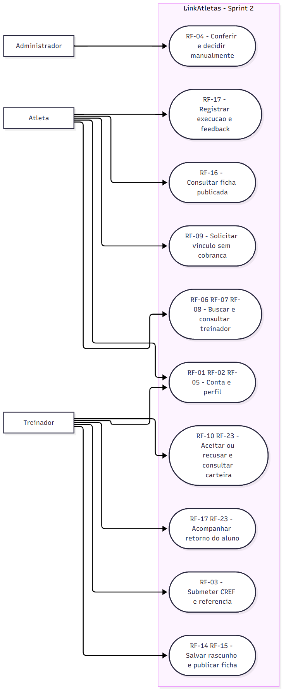
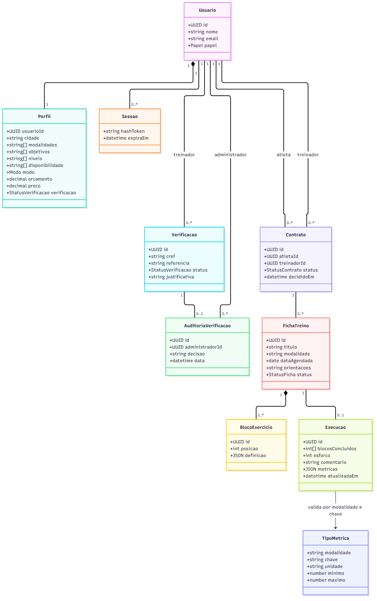
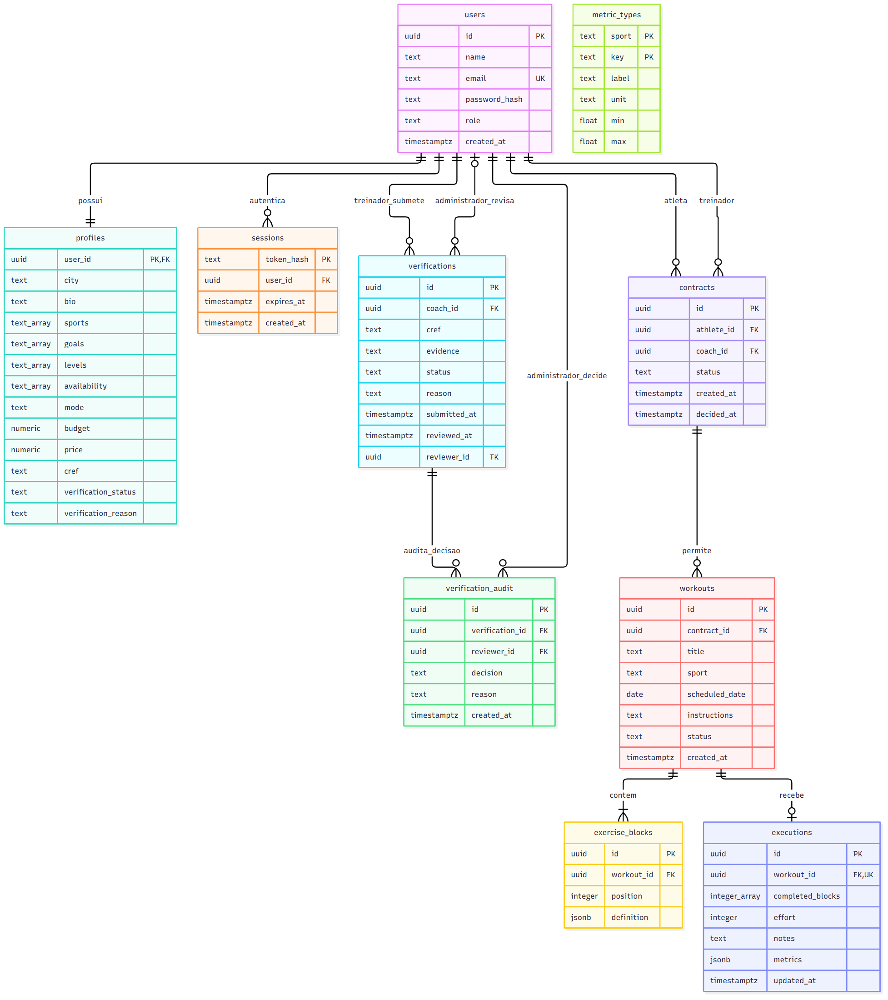
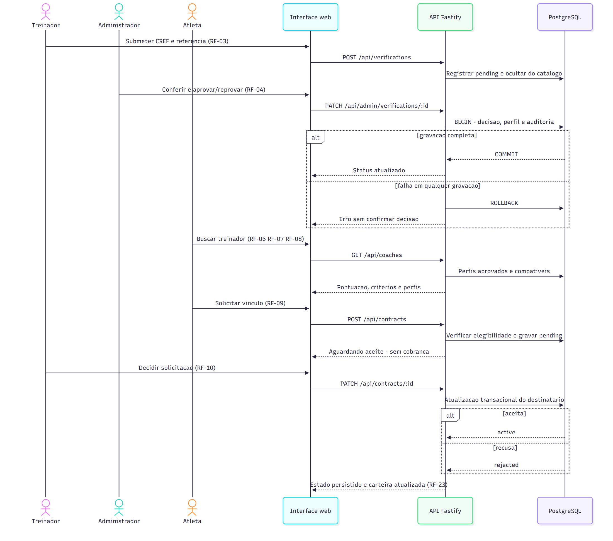
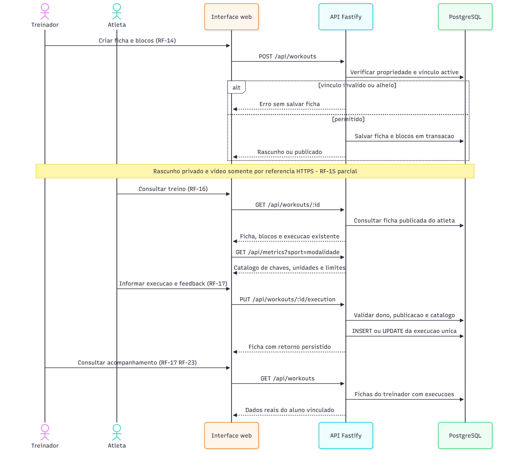

# Diagramas atualizados — Sprint 2

Data: 14/10/2026. Os diagramas representam o recorte implementado, com os identificadores RF da ERS textual. As fontes `.mmd` são editáveis. O diagrama de casos de uso usa notação de fluxo Mermaid para representar atores e objetivos; não é apresentado como arquivo UML de ferramenta proprietária.

| Categoria exigida | Fonte | Visualização |
|---|---|---|
| Casos de uso | [casos-de-uso.mmd](diagramas/casos-de-uso.mmd) | [PNG](diagramas/casos-de-uso.png) |
| Classes de domínio | [classes.mmd](diagramas/classes.mmd) | [PNG](diagramas/classes.png) |
| DER físico | [der.mmd](diagramas/der.mmd) | [PNG](diagramas/der.png) |
| Sequência 1: conferência, recomendação e contratação | [sequencia-contratacao.mmd](diagramas/sequencia-contratacao.mmd) | [PNG](diagramas/sequencia-contratacao.png) |
| Sequência 2: prescrição, execução e feedback | [sequencia-treino.mmd](diagramas/sequencia-treino.mmd) | [PNG](diagramas/sequencia-treino.png) |

Classes descrevem conceitos e não afirmam uso de ORM ou implementação orientada a objetos. O DER corresponde a `server/db/migrations/001_initial.sql`; `schema_migrations` é tabela técnica do aplicador e não integra o domínio.

As tabelas `profiles` usam arrays de modalidades/objetivos/níveis/horários; não há tabelas separadas para cada um desses catálogos neste incremento. `contracts` representa tanto solicitação quanto vínculo por transição de estado. `exercise_blocks.definition` e `executions.metrics` são JSONB. A relação entre valores de métricas e `metric_types` é validada pela API por modalidade/chave, sem chave estrangeira interna ao JSON.

Restrições compostas: um contrato por par atleta/treinador; um bloco por ficha/posição; uma execução por ficha; um tipo de métrica por modalidade/chave; uma verificação pendente por treinador. Revisor é opcional enquanto a solicitação está pendente. A auditoria é registrada junto à decisão e não possui endpoints de edição; o schema físico permite mais de uma linha por verificação, embora o fluxo atual produza no máximo uma decisão final. Obrigatoriedade de perfil por usuário e pelo menos um bloco por ficha são invariantes do fluxo de aplicação; as chaves estrangeiras, isoladamente, não obrigam a existência do registro filho.

Gateway, pagamentos, mídia S3, chat e aplicativo nativo não aparecem como participantes implementados. Uma referência de vídeo não cria entidade de upload. Para conferir o comportamento e as limitações, consultar [ERS](ERS-v1.1.md), [decisões](decisoes.md) e [relatório](relatorio-testes.md).

## Renderização reproduzível

Os arquivos podem ser abertos em visualizador Mermaid ou renderizados sem modificar as dependências da aplicação:

```powershell
pnpm dlx @mermaid-js/mermaid-cli@12.0.0 -i docs/sprint-2/diagramas/der.mmd -o docs/sprint-2/diagramas/der.png -b white --size 2200
```

Repetir para os cinco nomes da tabela. As imagens PNG são representações auxiliares; a fonte e a migration são referências para revisão de conteúdo. Os cinco PNG foram renderizados e inspecionados em 14/10/2026. O pnpm ignorou o script de download do Puppeteer neste ambiente; a renderização usou o Chrome já instalado, configurando `PUPPETEER_EXECUTABLE_PATH` para seu caminho local. Não foi necessário alterar dependências do projeto.

## Casos de uso



## Classes



## DER



## Sequência de contratação



## Sequência de treino


